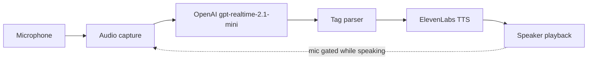
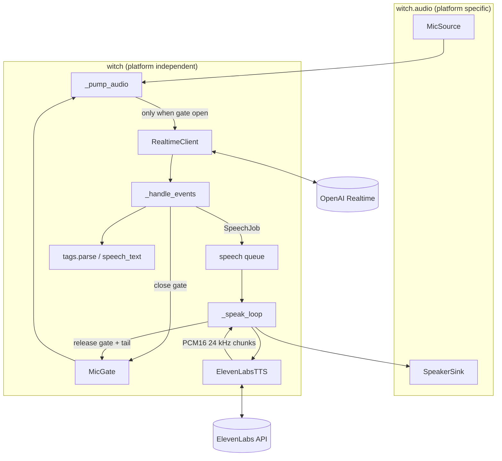

# Halloween Witch TTS - Design Document

Status: ready for implementation
Scope: MVP stage 2 - speak the witch's tagged text reply aloud using ElevenLabs
Depends on: `design-document-witch-MVP.prompt.md` (stage 1, already implemented)

## 1. Background

Stage 1 delivers `Mic -> Capture -> OpenAI Realtime (text only) -> Tag parser -> console`. This stage adds the last two boxes of the long-term pipeline:



The witch's reply (for example `[cackle] Ooh, a little ghost! [whispers] Come closer, dearie...`) is sent to ElevenLabs, which returns audio that is played on the local output device.

## 2. Goals and non-goals

### Goals
1. Speak every completed witch reply using the ElevenLabs voice `xBIfEFAROTtux2FvqTLj` ("Nadine - whispering witch of the dark forest").
2. Pass the performance tags through to the TTS model when it supports them; strip them when it does not.
3. Start playback as soon as the first audio bytes arrive (streamed HTTP), not after the full clip is generated.
4. Prevent the witch hearing herself: the microphone is gated while she speaks (half-duplex).
5. Keep platform-specific audio code inside `witch/audio/`; keep the TTS provider behind a small protocol so it can be swapped (Coqui, Bark) later.
6. A TTS failure never stops the app; it degrades to text-only with a logged error.

### Non-goals
- Barge-in during speech (the visitor cannot interrupt the witch in this stage).
- Webcam, GPIO, PIR, the witch's original sound board or servo triggers.
- Local/offline TTS (Coqui, Bark). Only the protocol seam is provided.
- Caching or pre-generating audio.
- Computing a USD cost for ElevenLabs (plan dependent); characters sent are logged instead.

## 3. Requirements

### Functional
| ID | Requirement |
|----|-------------|
| T1 | After a `completed` Realtime response, synthesize the reply with ElevenLabs and play it on the default (or configured) output device. |
| T2 | Voice id defaults to `xBIfEFAROTtux2FvqTLj`; model, voice and output device are configurable. |
| T3 | Request `pcm_24000` (mono, 16-bit little-endian, 24 kHz) so no resampling is needed on the normal path. |
| T4 | Use the HTTP streaming endpoint and feed audio to the speaker as chunks arrive. |
| T5 | For models that support audio tags (`eleven_v3*`, `eleven_v4*`) send text with allow-listed tags in place; for all other models send `clean_text`. Unknown tags are never sent. |
| T6 | Cancelled or failed responses are not spoken (unchanged from stage 1). |
| T7 | While a reply is being synthesized or played, and for a short tail afterwards, microphone audio is not sent to the Realtime API. |
| T8 | Replies are spoken one at a time, in order. |
| T9 | `--no-tts` / `WITCH_TTS=off` disables TTS entirely; `ELEVEN_LABS_API_KEY` is then not required. |
| T10 | `--say "text"` speaks the given text (tags allowed) and exits, without the microphone or the Realtime API. Used to audition voice and tags. |
| T11 | `--list-devices` lists output devices as well as input devices; `--output-device` selects one (index or name substring). |
| T12 | TTS errors (HTTP error, timeout, playback error) are logged and the app continues listening. |
| T13 | Ctrl+C stops playback immediately and exits cleanly. |

### Non-functional
| ID | Requirement |
|----|-------------|
| TN1 | Log time from end of visitor speech to first audible audio per turn. Target under 3 s; investigate if the median is higher (section 12). |
| TN2 | `ELEVEN_LABS_API_KEY` is read only from the environment / `.env`; never hard-coded, logged, or included in exceptions. |
| TN3 | New runtime dependency: `httpx` only (already installed transitively by `openai`; now declared explicitly). |
| TN4 | No platform-specific imports outside `audio/`. |
| TN5 | Python 3.11+, works on Windows and Raspberry Pi OS (64-bit). |

## 4. Technology choices

| Concern | Choice | Reason |
|---------|--------|--------|
| TTS service | ElevenLabs Text-to-Speech, `POST /v1/text-to-speech/{voice_id}/stream` | Requested; streamed response gives low time-to-first-audio. |
| HTTP client | `httpx.AsyncClient` with a persistent connection | Async streaming, connection reuse removes repeat TLS handshakes. No vendor SDK needed for one endpoint. |
| Default model | `eleven_v4_turbo` | Latest generation, built for real-time conversation (~100 ms model latency), expressive, interprets inline audio tags. Configurable via `WITCH_TTS_MODEL`. |
| Quality alternative | `eleven_v4` | Highest quality and voice accuracy; higher latency. Use if Turbo sounds worse for this voice. |
| Fallbacks | `eleven_v3` (previous generation, tags), `eleven_flash_v2_5` (~75 ms, no audio tags) | Use if v4 is unavailable for the voice over HTTP, or latency is too high on the night (section 12). |
| Output format | `pcm_24000` query parameter | Matches `SAMPLE_RATE = 24_000` used by capture; available on all plans (44.1 kHz PCM needs Pro). |
| Playback | `sounddevice.RawOutputStream` (24 kHz, mono, int16), blocking `write` run via `asyncio.to_thread` | Same dependency as capture; simple; works on Windows and Raspberry Pi. |
| Resampling fallback | `numpy` linear interpolation | Only if the output device rejects 24 kHz (same approach as `MicSource`). |

Notes on the ElevenLabs API (checked against the docs, 2026-10-18):
- Auth header is `xi-api-key`. Body is JSON: `text`, `model_id`, optional `voice_settings` (`stability`, `similarity_boost`, `style`, `speed`, `use_speaker_boost`).
- v4 (`eleven_v4`, `eleven_v4_turbo`) exposes only Stability and Similarity; Style and Speed are not available and SSML is not supported. This design only ever sends `stability`.
- `eleven_v4` has a 10,000 character request limit (v3: 5,000). Witch replies are about 200 characters.
- The docs describe v4 as the latest TTS model and mention its variants alongside the Text to Dialogue API. That `eleven_v4_turbo` is accepted by the plain `/v1/text-to-speech/{voice_id}/stream` endpoint is **not yet verified**; step 5 of section 10 verifies it with `--say`, and falls back to `eleven_v4` then `eleven_v3` if it is rejected.
- v4 follows the source voice more faithfully than v3, so Nadine may sound different on v4. Compare by ear (section 10, step 5).
- Library voices via the API require a paid plan. If `xBIfEFAROTtux2FvqTLj` is a shared-library voice, it may also need to be added to the account's voices. A 402/403/404 on first use means this; see troubleshooting (section 14).
- Audio tags are free-form text interpreted by the model. Which of our 12 tags have an audible effect depends on the model and voice. They must be auditioned (step 5 of section 10) and the allow-list trimmed if some are spoken literally or ignored.

## 5. Security prerequisites

- Add `ELEVEN_LABS_API_KEY=` (no value) to `.env.example`. The real key lives only in `.env`, which is already git-ignored.
- Never log the header, the key, or full request objects. Set the `httpx` and `httpcore` loggers to `WARNING` so request details are not emitted at `DEBUG`.
- Error messages surfaced from ElevenLabs may include the response body; log only the `detail.message` / `status` fields.
- Model output is untrusted text sent to a third party: it is restricted to allow-listed tags and the 1,000 character cap in section 7.2.

## 6. Project structure (changes only)

```
src/witch/
├── __main__.py        # + --no-tts, --say, --output-device; list output devices
├── app.py             # + speech worker, mic gate, TTS timing output
├── config.py          # + TTS settings
├── cost.py            # + optional tts_chars in the usage log line
├── gate.py            # NEW: MicGate (half-duplex gating)
├── persona.py         # + one prompt rule (section 8)
├── tags.py            # + speech_text()
├── audio/
│   ├── base.py        # + AudioSink protocol
│   ├── resample.py    # NEW: shared resample(pcm, src_rate, dst_rate), moved from mic.py
│   ├── mic.py         # uses audio/resample.py
│   └── speaker.py     # NEW: SpeakerSink (sounddevice output)
└── tts/
    ├── __init__.py
    ├── base.py        # NEW: TextToSpeech protocol, TTSError
    └── elevenlabs.py  # NEW: ElevenLabsTTS
tests/
├── test_tags.py       # + speech_text tests
├── test_config.py     # + TTS config tests
├── test_gate.py       # NEW
└── test_elevenlabs.py # NEW (httpx.MockTransport, no network)
```

## 7. Architecture



### 7.1 Text-to-speech provider (`tts/base.py`, `tts/elevenlabs.py`)

```python
class TTSError(RuntimeError):
    """Synthesis failed. The message is safe to log (never contains the API key)."""

class TextToSpeech(Protocol):
    async def __aenter__(self) -> TextToSpeech: ...
    async def __aexit__(self, *exc_info: object) -> None: ...
    def synthesize(self, text: str) -> AsyncIterator[bytes]:
        """Yield mono 16-bit little-endian PCM at SAMPLE_RATE, even byte lengths. Raises TTSError."""
```

`ElevenLabsTTS(settings, transport=None)` (the optional `httpx` transport exists so tests can inject `httpx.MockTransport`):
- `__aenter__` creates one `httpx.AsyncClient(base_url="https://api.elevenlabs.io", headers={"xi-api-key": key}, timeout=httpx.Timeout(connect=5, read=10, write=5, pool=5))`; `__aexit__` closes it.
- `synthesize(text)`:
  1. `client.stream("POST", f"/v1/text-to-speech/{voice_id}/stream", params={"output_format": "pcm_24000"}, json=body)`.
  2. Body: `{"text": text, "model_id": settings.tts_model}`, plus `"voice_settings": {"stability": x}` only if `WITCH_TTS_STABILITY` is set (otherwise the voice's stored settings are used).
  3. On a non-2xx status: `await response.aread()`, extract `detail.message` (or `detail.status`) from the JSON body if present, raise `TTSError(f"ElevenLabs HTTP {status}: {message}")`.
  4. Iterate `response.aiter_bytes()`. HTTP chunk boundaries are arbitrary, so keep a one-byte carry: always yield an even number of bytes, prepend any leftover byte to the next chunk, and drop a final odd byte with a DEBUG log.
  5. Wrap `httpx.HTTPError` (timeouts, connection errors) in `TTSError` using `type(exc).__name__` only.
- No automatic retry: a late reply is worse than a missed one for a person standing at the door. The next visitor utterance gets a fresh attempt.
- Never log request headers. Log the text length, model and status at DEBUG.

### 7.2 Speech text (`tags.py`)

```python
MAX_TTS_CHARS = 1_000

def speech_text(response: WitchResponse, *, keep_tags: bool) -> str:
    """Text to send to TTS. Empty string means there is nothing to say."""
```

Rules:
1. `keep_tags=False`: return `response.clean_text`.
2. `keep_tags=True`: rebuild from `response.segments`, emitting `[tag] text` for tagged segments and bare `text` for the leading untagged segment, joined by single spaces. A trailing tag with no text after it is kept (for example `Come closer... [evil laugh]`). Unknown tags are never present because `parse` already removed them.
3. Apply the same whitespace and space-before-punctuation normalisation as `parse`.
4. If the result is longer than `MAX_TTS_CHARS`, truncate at the last sentence end (`.`, `!`, `?`) before the limit, or at the limit if none, and log a WARNING.
5. Whitespace-only input returns `""`; the caller skips synthesis.

Which models keep tags is decided in `config.py` by `tts_supports_tags(model_id)`: true if the id starts with `eleven_v3` or `eleven_v4`. Everything else (`eleven_flash_v2_5`, `eleven_multilingual_v2`, ...) gets clean text.

### 7.3 Speaker (`audio/base.py`, `audio/speaker.py`)

```python
class AudioSink(Protocol):
    async def __aenter__(self) -> AudioSink: ...
    async def __aexit__(self, *exc_info: object) -> None: ...
    async def play(self, chunks: AsyncIterator[bytes]) -> None:
        """Play mono PCM16 at SAMPLE_RATE; returns when all audio has been written and drained."""
```

`SpeakerSink` behaviour:
- `__aenter__` opens and starts one persistent `sounddevice.RawOutputStream(samplerate=24000, channels=1, dtype="int16", device=...)`. A persistent stream avoids start-up clicks and device latency on every reply.
- If opening at 24 kHz raises `PortAudioError`, open at the device's default rate and resample each chunk with `audio/resample.py`. Log which path was taken.
- `play` loops `async for chunk in chunks:` and writes each chunk with `await asyncio.to_thread(stream.write, chunk)` (the call blocks until the device buffer has room, which paces playback). Chunks passed to `stream.write` must be whole frames (even bytes).
- To avoid an audible underrun at the start, `play` buffers the first 100 ms of audio (4,800 bytes) before the first write, or whatever has arrived when the stream ends.
- After the last chunk, drain by writing 100 ms of silence so the tail is not clipped.
- On `CancelledError` or any exception: `stream.abort()` (discard buffered audio immediately), restart the stream so the sink stays usable, and re-raise.
- `device` accepts an integer index or a name substring (first output-capable device, case-insensitive). `list_output_devices()` and `resolve_output_device()` mirror the input helpers in `mic.py`; an unknown name raises `ConfigError`.
- `_resample` in `mic.py` is generalised to `resample(pcm, src_rate, dst_rate)` in `audio/resample.py` and used by both classes. Behaviour of `MicSource` is unchanged.

### 7.4 Half-duplex gating (`gate.py`)

The microphone would otherwise pick up the witch's own voice and the Realtime model would answer it in a loop.

```python
class MicGate:
    def __init__(self, clock: Callable[[], float] = time.monotonic) -> None: ...
    def close(self) -> None: ...                 # gate closed until release() is called
    def release(self, tail_s: float) -> None: ... # reopen tail_s seconds from now
    @property
    def is_open(self) -> bool: ...
```

- `is_open` is `not closed and clock() >= reopen_at`. The clock is injectable for tests.
- `close()` is called synchronously by `_handle_events` at `RESPONSE_DONE (completed)` before the job is queued, so there is no window in which the mic is open while the witch is about to speak.
- `release(tail_s)` is called by the speech worker in a `finally` block after every job (success, error or cancellation). The tail (`WITCH_GATE_TAIL_MS`, default 400 ms) lets room echo die away.
- While the gate is closed `_pump_audio` still reads from the mic (so the capture queue never overflows) but discards the chunk instead of calling `rt.send_audio`.
- If several jobs are queued, the gate stays closed until the last one finishes: `close()` increments a pending count and `release()` decrements it; the gate is open only when the count is zero and the tail has elapsed.
- Consequence: the visitor cannot interrupt the witch (non-goal). If the visitor starts talking before the Realtime response finishes, the server cancels the response; nothing is spoken and the gate is never closed.

### 7.5 Orchestration (`app.py`)

```python
@dataclass(frozen=True)
class SpeechJob:
    text: str
    speech_ended_at: float | None   # loop time of SPEECH_STOPPED, for latency
```

`run(settings)`:

```python
async with MicSource(settings) as mic:
    async with AsyncExitStack() as stack:
        queue: asyncio.Queue[SpeechJob] = asyncio.Queue()
        gate = MicGate()
        if settings.tts_enabled:
            tts = await stack.enter_async_context(ElevenLabsTTS(settings))
            sink = await stack.enter_async_context(SpeakerSink(settings))
            worker = asyncio.create_task(_speak_loop(queue, tts, sink, gate, settings), name="speak")
            stack.callback(worker.cancel)
        while True:               # existing reconnect loop, now passing queue and gate
            ...
```

- The worker lives across Realtime reconnects. A reconnect during speech does not interrupt the audio; the gate stays closed until playback ends.
- `_pump_audio(mic, rt, gate)`: `async for chunk in mic.chunks(): if gate.is_open: await rt.send_audio(chunk)`.
- `_handle_events`, on `ResponseDone` with status `completed`:
  1. `parsed = tags.parse(done.text)`; print the structured block as in stage 1.
  2. If TTS is enabled: `text = tags.speech_text(parsed, keep_tags=settings.tts_keep_tags)`. If `text` is non-empty, `gate.close()` and `queue.put_nowait(SpeechJob(text, speech_ended_at))`.
  3. `tracker.record(..., tts_chars=len(text))` (section 7.8).
- `_speak_loop`:

```python
while True:
    job = await queue.get()
    first_audio_at = None
    started = loop.time()
    try:
        async def audio() -> AsyncIterator[bytes]:
            nonlocal first_audio_at
            async for chunk in tts.synthesize(job.text):
                if first_audio_at is None:
                    first_audio_at = loop.time()
                yield chunk
        await sink.play(audio())
        _print_speech_result(job, first_audio_at, loop.time() - started)
    except TTSError as exc:
        log.error("TTS failed: %s", exc)
    except (sd.PortAudioError, OSError) as exc:
        log.error("Playback failed: %s", exc)
    finally:
        gate.release(settings.gate_tail_s)
```

  `CancelledError` propagates (shutdown) after the `finally` runs.
- Errors from TTS and playback are never raised out of the worker, so a bad request cannot kill the session or the listener.
- Existing behaviour is unchanged when TTS is disabled.
- `first_audio_at` is the time the first chunk was received from ElevenLabs; actual audible output is at most about 100 ms later (the playback pre-buffer).

### 7.6 `--say` mode (`__main__.py`)

`--say TEXT` runs a short coroutine: `parse(TEXT)`, `speech_text(...)`, `ElevenLabsTTS` + `SpeakerSink`, `play`, then exit 0. It must not open the microphone or require `OPENAI_API_KEY`, so `load_settings` gains `require_openai: bool = True` and `--say` passes `False`. `--say` ignores `WITCH_TTS=off` but still requires `ELEVEN_LABS_API_KEY`. It prints the exact text sent to ElevenLabs (tags included) and the time to first audio. TTS errors exit with code 1.

### 7.7 Configuration (`config.py`)

New `Settings` fields (all frozen, defaults shown):

| Field | Env var | CLI | Default |
|-------|---------|-----|---------|
| `eleven_api_key: str \| None` (`repr=False`) | `ELEVEN_LABS_API_KEY` | - | `None` |
| `tts_enabled: bool` | `WITCH_TTS` (`on`/`off`) | `--no-tts` | `True` |
| `voice_id: str` | `WITCH_VOICE_ID` | - | `xBIfEFAROTtux2FvqTLj` |
| `tts_model: str` | `WITCH_TTS_MODEL` | - | `eleven_v4_turbo` |
| `tts_stability: float \| None` | `WITCH_TTS_STABILITY` | - | `None` (voice default) |
| `output_device: int \| str \| None` | `WITCH_OUTPUT_DEVICE` | `--output-device` | `None` |
| `gate_tail_ms: int` | `WITCH_GATE_TAIL_MS` | - | `400` |

Derived properties (not stored): `Settings.tts_keep_tags` = `tts_supports_tags(tts_model)`; `Settings.gate_tail_s` = `gate_tail_ms / 1000`.

Validation:
- `tts_enabled` and no `ELEVEN_LABS_API_KEY`: `ConfigError("ELEVEN_LABS_API_KEY not set. Add it to .env or run with --no-tts")`. Never print a key value.
- `WITCH_TTS` must be `on` or `off`; `WITCH_TTS_STABILITY`, if set, must be a float in `[0, 1]`; `WITCH_GATE_TAIL_MS` must be a non-negative integer. Violations raise `ConfigError` with the variable name.
- `WITCH_VOICE_ID` is stripped and must be non-empty alphanumeric (it is placed in a URL path); otherwise `ConfigError`.
- Real environment overrides `.env`; CLI overrides both (unchanged rule).

`.env.example` additions:

```
ELEVEN_LABS_API_KEY=

# WITCH_TTS=on
# WITCH_VOICE_ID=xBIfEFAROTtux2FvqTLj
# WITCH_TTS_MODEL=eleven_v4_turbo
# WITCH_TTS_STABILITY=
# WITCH_OUTPUT_DEVICE=
# WITCH_GATE_TAIL_MS=400
```

### 7.8 Cost and usage logging (`cost.py`)

- `CostTracker.record(...)` gains `tts_chars: int = 0`; the usage JSONL line gains `"tts_chars"` (0 when TTS is off or nothing was spoken). `InteractionCost` gains the same field.
- The ElevenLabs charge is plan dependent, so no USD is computed. `format_interaction` appends `tts chars N` when `N > 0`.
- `_report` needs the character count, so the `speech_text` call happens before `tracker.record`.

## 8. Persona and tag contract changes

- `persona.ALLOWED_TAGS` remains the single source of truth for the parser and the prompt.
- Add one rule to the system prompt: `- Write numbers and symbols as words so they are spoken naturally.`
- The v4 docs show descriptive tags such as `[quietly curious]` or `[under his breath]`, so the model is not limited to a fixed tag vocabulary. Our short allow-list stays (it keeps the parser and prompt strict); consider replacing weak tags with more descriptive ones that audition well, such as `[mischievously]`.
- The chosen voice is already a whisper voice, so `[whispers]` may have little audible effect. After auditioning (section 10, step 5) remove tags that are ignored or spoken literally, and prefer tags that change delivery audibly. Only `persona.py` changes; tests that reference the tag list must read `ALLOWED_TAGS` rather than hard-code it.

## 9. Console output format

Stage 1 output is unchanged. After the response block, when TTS is enabled, one more line is printed once playback finishes:

```
speech> 112 chars, first audio 1850 ms after end of speech, played 5.3 s
```

If `speech_ended_at` is unknown the first-audio figure is `n/a`. Failures go to stderr via `logging` (`TTS failed: ElevenLabs HTTP 402: ...`).

## 10. Implementation plan

Each step is independently runnable and verifiable.

1. **Hygiene** - add `ELEVEN_LABS_API_KEY` to `.env.example`; confirm `.env` is git-ignored; add `httpx>=0.27` to `requirements.txt` and `pyproject.toml` dependencies.
2. **`config.py`** - new fields, validation, `tts_supports_tags`, `require_openai`; extend `tests/test_config.py`.
3. **`tags.speech_text`** - implement and unit test (section 12).
4. **`audio/resample.py` and `audio/speaker.py`** - move/generalise the resampler, implement `SpeakerSink`, `list_output_devices`, `resolve_output_device`, update `--list-devices`. Check: a throwaway script plays one second of a 440 Hz sine at 24 kHz with no gaps or clicks.
5. **`tts/` and `--say`** - implement `ElevenLabsTTS`, add `--say`, write `tests/test_elevenlabs.py`. Check: `python -m witch --say "[cackle] Ooh, a little ghost at my door!"` is audible. **Audition every tag in `ALLOWED_TAGS` individually** (for example `--say "[growl] Come closer."`) with `eleven_v4_turbo`, `eleven_v4` and `eleven_v3`; trim the allow-list per section 8. First confirm `eleven_v4_turbo` is accepted by the HTTP `/stream` endpoint; if the API rejects it, record the error and use `eleven_v4`. Pick the default by ear and by time to first audio.
6. **`gate.py` and `app.py`** - gate, speech queue, worker, timing line, reconnect-safe lifetime; update `cost.py` (`tts_chars`). Check: end-to-end with headphones first, then with speakers.
7. **Tune** - `gate_tail_ms`, stability, model choice, speaker volume and mic position against real visitors and background noise.
8. **README** - setup, env vars, `--say`, troubleshooting (section 14), Raspberry Pi audio notes.

## 11. Future work (design must not block it)

1. **Barge-in / full duplex**: needs acoustic echo cancellation or careful mic placement; the gate would be replaced, and `AudioSink.play` is already cancellable.
2. **Sentence-level streaming**: split the Realtime text stream at sentence ends and synthesize while the LLM is still generating, using `previous_text` / `next_text` for prosody. Only worth it if latency is too high; replies are 1-2 sentences.
3. **Alternative providers**: Coqui/XTTS v2 or Bark behind the `TextToSpeech` protocol; providers without tag support use `clean_text` (already handled by `keep_tags`).
4. **Witch speaker integration**: route the output device to the animatronic's own speaker (or an amplifier) and trigger the jump/eyes via MCU at the start of playback (`first_audio_at` is the hook).
5. **Local cackle cache**: pre-generated audio for tag-only replies, or as an offline fallback when ElevenLabs is unreachable.
6. **Webcam, PIR trigger, Raspberry Pi `systemd` service** as listed in the MVP document.

## 12. Testing

### Unit tests (automated, no network)
`tests/test_tags.py` (`speech_text`):
- `keep_tags=True` with a leading untagged segment, a middle tag and a trailing tag produces `Ooh, hello. [whispers] Come closer. [evil laugh]`.
- `keep_tags=False` equals `clean_text`.
- Unknown tags never appear in either mode.
- Empty and whitespace-only responses return `""`.
- Text over `MAX_TTS_CHARS` is truncated at a sentence end.

`tests/test_config.py`:
- Missing `ELEVEN_LABS_API_KEY` with TTS enabled raises `ConfigError`; with `WITCH_TTS=off` it does not.
- Defaults: voice id `xBIfEFAROTtux2FvqTLj`, model `eleven_v4_turbo`, tail 400 ms.
- Invalid `WITCH_TTS`, stability outside `[0, 1]`, negative tail, and a voice id containing `/` or spaces raise `ConfigError`.
- `tts_supports_tags`: true for `eleven_v3`, `eleven_v3_conversational`, `eleven_v4`, `eleven_v4_turbo`; false for `eleven_flash_v2_5`, `eleven_multilingual_v2`.
- `require_openai=False` loads without `OPENAI_API_KEY`.
- The API key does not appear in `repr(settings)`.

`tests/test_elevenlabs.py` (`httpx.MockTransport` injected into `ElevenLabsTTS`):
- Request is `POST /v1/text-to-speech/xBIfEFAROTtux2FvqTLj/stream?output_format=pcm_24000` with header `xi-api-key` and JSON body containing `text` and `model_id`; `voice_settings` only when stability is set.
- Chunks split at odd byte boundaries are re-emitted as even-length chunks with no lost bytes.
- HTTP 401, 402, 422 and 500 raise `TTSError` containing the status and server message but not the API key.
- A transport timeout raises `TTSError`.

`tests/test_gate.py` (fake clock):
- Open by default; `close()` closes; `release(0.4)` stays closed until 0.4 s have passed; two `close()` calls need two `release()` calls before the tail starts.

### Manual acceptance (Windows laptop, headphones first)
| # | Scenario | Expected |
|---|----------|----------|
| B1 | `python -m witch --list-devices` | Input and output devices listed. |
| B2 | `python -m witch --say "[cackle] Ooh, a little ghost at my door!"` | Spoken in Nadine's voice; prints text sent and first-audio time. |
| B3 | `--say` for each allowed tag | Each tag audibly changes delivery or is removed from the allow-list. |
| B4 | Say "Trick or treat!" | Reply printed as in stage 1, then spoken; `speech>` line printed. |
| B5 | Speak while the witch is talking | Witch is not interrupted; the visitor's speech is not answered; listening resumes after the tail. |
| B6 | Run on speakers | Witch never replies to her own voice (no feedback loop). |
| B7 | Unset `ELEVEN_LABS_API_KEY`, run normally | Clear error, exit code 2. With `--no-tts` it runs text-only. |
| B8 | Invalid API key | `TTS failed: ElevenLabs HTTP 401 ...` logged; app keeps listening and printing text. |
| B9 | Disconnect network during a speech request | Error logged within about 10 s; app resumes; next reply works after reconnect. |
| B10 | Ctrl+C during playback | Audio stops at once; process exits within 2 s with no traceback. |
| B11 | Latency | Median end-of-speech to first audio logged; target under 3 s (TN1). |
| B12 | `--output-device <name substring>` | Audio plays on the selected device. |

## 13. Raspberry Pi portability checklist

- Playback goes through `witch.audio.SpeakerSink` only; no direct `sounddevice` use elsewhere.
- Output device selected by name substring (indices change between boots on Linux); ALSA default or USB speaker/DAC.
- `libportaudio2` is already required for capture; no new system packages.
- No numpy work on the normal path (24 kHz PCM goes straight to the device); resampling only on the fallback path.
- All configuration via env vars so a `systemd` unit can set them, including `ELEVEN_LABS_API_KEY`.

## 14. Troubleshooting notes (include in README)

- `ELEVEN_LABS_API_KEY not set`: add it to `.env`, or run with `--no-tts`.
- `ElevenLabs HTTP 401`: key invalid or revoked.
- `ElevenLabs HTTP 402/403/404` mentioning the voice or a paid plan: the voice is a shared-library voice. Use a paid plan and add `xBIfEFAROTtux2FvqTLj` to the account's voices, or set `WITCH_VOICE_ID` to another voice.
- `ElevenLabs HTTP 429`: concurrency or quota limit; the reply is skipped.
- Tags read aloud or having no effect: remove the tag from `persona.ALLOWED_TAGS`, or switch to a model without tag support (`WITCH_TTS_MODEL=eleven_flash_v2_5`, which receives clean text).
- Long delay before the witch speaks: make sure `WITCH_TTS_MODEL=eleven_v4_turbo` (not `eleven_v4`) is in use; otherwise try `eleven_flash_v2_5`; check network latency.
- Witch answers herself or cuts off the end of her own sentence: increase `WITCH_GATE_TAIL_MS`, lower the volume or move the mic away from the speaker.
- `PortAudioError: Invalid sample rate` on output: the resample fallback should engage; check logs and try another `--output-device`.
- Crackling or gaps: another application holds the device in exclusive mode, or the machine is overloaded.

## 15. Decisions and remaining open questions

Decisions made in this document:
1. HTTP streaming (not WebSocket) because replies are short and it keeps the client simple.
2. The whole reply is synthesized in one request after `response.done`, not per sentence.
3. Half-duplex gating drops mic chunks rather than sending silence (cheaper; the server VAD simply sees a gap).
4. No retry on TTS failure; fail soft and continue listening.
5. `eleven_v4_turbo` is the default (latest generation, real-time, tag support); other models are configuration only.

Open (decide during implementation; defaults in brackets):
1. Does `eleven_v4_turbo` work on the HTTP `/stream` endpoint, and does it meet the 3 s latency target? [Verify in step 5, measure in step 6; fall back to `eleven_v4`, `eleven_v3`, then Flash.]
2. Which of the 12 tags are worth keeping for this voice? [Decide from the step 5 audition.]
3. Does the Nadine voice need adding to the account before the API accepts it? [Check in step 5.]
4. Default `WITCH_TTS_STABILITY`. [Leave unset; verify any value against the API for the chosen model before documenting it.]
