# Halloween Witch Behaviour - Design Document

Status: implemented (see section 13 for deviations)
Scope: make the witch feel alive - (1) a presence confidence threshold before she activates, and (2) a periodic ambient sound after a long period of inactivity
Depends on: `design-document-witch-hardware-and-run-control.prompt.md`, `design-document-witch-first-to-speak.prompt.md` and `design-document-witch-adding-tts.prompt.md`, all implemented

## 1. Background

Today `RunController.run()` is `WAITING -> ACTIVE -> COOLDOWN -> REARM`, and `WAITING` is a single call, `sensor.wait_for_motion()`, which returns on the first PIR rising edge. Two problems:

1. **She activates on the first blip.** Anyone walking past, or a PIR false trigger, sets her off at once. That is rigid and annoying.
2. **She is silent between visitors.** A Bluetooth speaker goes to sleep after a few minutes without audio, and a silent prop gives no hint that it is alive.

This stage replaces the instant trigger with an accumulated "confidence" that someone is really there, and adds a low-key ambient sound that plays after a long quiet spell.

```mermaid
stateDiagram-v2
    [*] --> WARMUP
    WARMUP --> WAITING
    WAITING --> WAITING: sample PIR every 100 ms<br/>confidence rises or decays
    WAITING --> AMBIENT: inactivity timer expired
    AMBIENT --> WAITING: sound finished (PIR ignored meanwhile)
    WAITING --> ACTIVE: confidence >= threshold<br/>or Enter pressed (keyboard)
    ACTIVE --> COOLDOWN
    COOLDOWN --> REARM
    REARM --> WAITING: PIR low; confidence = 0; new random threshold
```



Everything after `WAITING` (conversation, opening line, pulse, cooldown, rearm) is unchanged.

## 2. Goals and non-goals

### Goals
1. She activates only after the PIR has been high for roughly 10 s in total (randomised per activation), not on the first blip.
2. Short or intermittent presence fades away instead of being remembered forever.
3. After about 5 minutes (configurable, randomised) with no real activity (presence confidence below 50% of the threshold) she plays one short phrase in her own voice, audio only.
4. The phrase list is a plain list of strings; adding a phrase is a one-line edit.
5. The phrase audio is generated by the existing ElevenLabs voice, and cached on disk so that each phrase sounds identical every time and replays cost nothing.
6. Both new behaviours are tunable by environment variable and can be turned off, which restores today's behaviour.
7. The new logic is pure and clock-injected so it is unit tested without sleeping.

### Non-goals
- Anything about the conversation, persona, opening line, pulse or cooldown.
- Moving the witch (no activate-pin pulse) for ambient sounds. They are audio only.
- Real space-bar input. The keyboard test trigger stays "press Enter".
- Using the Realtime API or the microphone for ambient sounds.
- Distinguishing people from animals, or one person from several.
- Pre-generating the phrase audio at startup (section 11).

## 3. Requirements

### Functional: presence confidence
| ID | Requirement |
|----|-------------|
| P1 | While in `WAITING` the controller samples `sensor.is_active` every `TICK_S` (0.1 s). Each sample adds its elapsed time `dt` to a confidence value if the PIR is high, and subtracts `dt * decay` if it is low. Confidence never goes below 0. |
| P2 | She activates when `confidence >= threshold`. |
| P3 | `threshold = WITCH_PRESENCE_THRESHOLD_S * uniform(0.5, 1.5)`, rolled once at the start of each `WAITING` phase (so once per activation), and held fixed within that phase. |
| P4 | `decay` is `WITCH_PRESENCE_DECAY` (default 0.5): lose one second of confidence for every two seconds of PIR silence. Confidence from a brief visit is gone after twice as long as the visit. |
| P5 | Confidence is reset to 0 and a new threshold is rolled each time `WAITING` begins, i.e. after the cooldown and the existing "PIR must go low" rearm. Nothing carries over between activations. |
| P6 | `WITCH_PRESENCE_THRESHOLD_S=0` disables the feature: the first high sample activates, matching today's behaviour. |
| P7 | The keyboard trigger bypasses the threshold: each Enter activates immediately (decision from the review of this document). |
| P8 | Presses of Enter made during warm-up, conversation or cooldown are discarded when `WAITING` begins, as edges are today. A press made while an ambient sound is playing is kept and activates her as soon as the sound ends. |

### Functional: ambient sound
| ID | Requirement |
|----|-------------|
| A1 | An inactivity timer runs during `WAITING`. When it reaches `interval = WITCH_AMBIENT_INTERVAL_S * uniform(0.5, 1.5)` (default 300 s, so 150 to 450 s), one phrase is played. A new interval is rolled each time the timer is restarted. |
| A2 | Only real activity restarts the timer, without re-rolling it: presence confidence at or above `AMBIENT_RESET_FRACTION` (0.5, i.e. 50%) of the current threshold, an Enter press, an activation, or an ambient sound finishing. Small PIR blips that never lift confidence to 50% do not restart it, so a flickering PIR cannot suppress the ambient sounds. While confidence stays at or above 50% the timer is held restarted on every sample; once confidence decays below 50% it counts again from the last restart. The timer is also restarted when `WAITING` begins, so the quiet period is measured from the end of the last conversation or cooldown. |
| A3 | While a phrase is playing, PIR samples are ignored: confidence is neither raised nor decayed and the timer is not touched. Sampling resumes when playback ends and the elapsed time of the sound is not counted. |
| A4 | Phrases come from `PERIODIC_PHRASES` in `phrases.py`, a plain tuple of strings, drawn by the same shuffle-bag rule as the opening cues: every phrase once before any repeats, never the same phrase twice in a row. |
| A5 | Adding a phrase means adding one string to that tuple. No other file, test or count changes. |
| A6 | Each phrase is converted with `tags.trusted_speech_text(phrase, keep_tags=settings.tts_keep_tags)`. It deliberately bypasses the `ALLOWED_TAGS` whitelist that `tags.parse` applies to model replies, because the operator writes these phrases and every tag in the list (`[cackle]`, `[softly]`, ...) must survive. With a tag-capable model (`eleven_v3`, `eleven_v4*`) the tags are sent; with any other model they are stripped. |
| A7 | Audio is synthesised by `ElevenLabsTTS` with the configured voice and model, played through `SpeakerSink`, and saved to a disk cache keyed by (model, voice id, stability, output format, spoken text). A cache hit plays from disk and makes no network call. |
| A8 | Ambient sounds are audio only: no activate-pin pulse, no Realtime session, no microphone, no cost record. |
| A9 | `WITCH_AMBIENT_INTERVAL_S=0` or `--no-tts` (or `WITCH_TTS=off`) disables ambient sounds. With TTS off a single INFO line says so at start-up. |
| A10 | A failure to synthesise or play (TTS error, playback error, hang) is logged at WARNING, the timer is restarted with a new interval, and the controller carries on. It never ends the run and never retries in a tight loop. |
| A11 | Playback is bounded by `AMBIENT_TIMEOUT_S` (60 s) so a hung device cannot leave her deaf to the PIR. |

### Non-functional
| ID | Requirement |
|----|-------------|
| N1 | Sampling adds no measurable CPU: one `is_active` read and a few float operations every 100 ms. |
| N2 | A first-ever play of a phrase starts within about 2 s (one ElevenLabs request); a cached phrase starts within 200 ms. |
| N3 | Confidence and the timer use `time.monotonic` deltas, never wall-clock time, and a long stall (for example a slow sound) cannot produce a huge `dt`: each `dt` is capped at 1 s. |
| N4 | New code follows the repository's existing conventions: frozen `Settings`, `_parse_*` helpers, injectable clock and RNG, `log.info` state lines such as `state> WAITING`. |

## 4. Phrase list

Copy of the list in the request, verbatim. The curly apostrophes are intentional (`’`).

```python
PERIODIC_PHRASES: tuple[str, ...] = (
    "[cackle] ha",
    "[cackle] boil boil cauldron bubble, turn this frog into a puddle",
    "[whispering] Double, double toil and trouble; Fire burn, and caldron bubble",
    "[playful] Well there’s a little witch in all of us.",
    "[cackle] [angry] who goes there?",
    "[softly] Come closer, my pretties...",
    "[excited] The cauldron’s bubbling nicely.",
    "[singing] Brewing up a little trouble.",
    "[bored] Is it midnight yet?",
)
```

To add a sound, append a string. Tags in square brackets are only spoken as performance cues with the v3/v4 model; with other models they are stripped (A6), so the text after the tags must read naturally on its own.

## 5. Design

### 5.1 Presence tracker (`presence.py`, new)

A pure class with no I/O and no clock, so it is trivially testable:

```python
class PresenceTracker:
    def __init__(self, base_threshold_s: float, decay: float,
                 rng: random.Random | None = None,
                 jitter: tuple[float, float] = PRESENCE_JITTER) -> None: ...

    @property
    def confidence(self) -> float: ...
    @property
    def threshold(self) -> float: ...
    @property
    def progress(self) -> float:
        """confidence / threshold (0 when confidence is 0; 1 when the threshold is 0 and confidence > 0)."""

    def reset(self) -> None:
        """Confidence to 0 and roll a new threshold."""

    def update(self, active: bool, dt: float) -> bool:
        """Apply one sample. Returns True once confidence has reached the threshold."""
```

- `update`: `active` adds `dt`; otherwise subtracts `dt * decay`; clamp at 0; return `confidence >= threshold`.
- `reset` rolls `threshold = base * rng.uniform(*jitter)`. With `base == 0` the threshold is 0 and the first high sample triggers (P6). A low sample must never trigger, so the test is `confidence >= threshold and confidence > 0`.
- `PRESENCE_JITTER = (0.5, 1.5)` and `AMBIENT_RESET_FRACTION = 0.5` live in `config.py` next to the defaults.
- `progress` is what the controller compares with `AMBIENT_RESET_FRACTION`. It is relative to the threshold rolled for this activation, so the bar for "real activity" moves with it (for example 5 s of a 10 s threshold).

### 5.2 Generic shuffle bag (`bag.py`, new) and `opening.py`

`OpeningPicker` already implements exactly the rule in A4, but is typed to `Opening`. Move the algorithm into a generic `ShuffleBag[T]` (same `next`, `size`, `position`, same RNG injection, same "no repeat across a refill" swap) and make `OpeningPicker` a thin subclass that defaults to `OPENING_PROMPTS`. Behaviour of the opening picker and its tests does not change. The ambient player uses `ShuffleBag(PERIODIC_PHRASES)`.

### 5.3 Sensor seam (`hardware/base.py`, `hardware/fake.py`)

The keyboard sensor has no held level (`is_active` is always `False`), and it has to bypass the threshold (P7). Add one method to the `MotionSensor` protocol:

```python
def take_manual_trigger(self) -> bool:
    """True once for each operator-forced activation since the last call. PIR sensors return False."""
```

- `KeyboardSensor`: the stdin thread sets a flag per Enter (a `threading.Event`, or an `EdgeLatch`-style counter); `take_manual_trigger` returns and clears it.
- `GpioMotionSensor` and `Esp32MotionSensor`: `return False`.
- `wait_for_motion` is no longer called by the controller. It stays in the protocol and implementations for now so that `test_esp32.py` and the selftest keep working; deleting it is a separate cleanup (section 12). `wait_for_still` is still used by the rearm step.

### 5.4 Ambient player (`ambient.py`, new, and `phrases.py`, new)

```python
class AmbientSound(Protocol):
    async def play_next(self) -> None: ...      # never raises for TTS/playback failures

class PhraseCache:
    def __init__(self, directory: Path | None) -> None: ...   # None disables caching
    def path_for(self, key: str) -> Path: ...
    async def read(self, key: str) -> bytes | None
    async def write(self, key: str, pcm: bytes) -> None       # temp file + os.replace

class AmbientPlayer:
    def __init__(self, settings, bag: ShuffleBag[str], cache: PhraseCache,
                 tts_factory=ElevenLabsTTS, sink_factory=SpeakerSink) -> None: ...
    async def play_next(self) -> None
```

`play_next` steps:
1. `phrase = bag.next()`; `speech = tags.trusted_speech_text(phrase, keep_tags=settings.tts_keep_tags)`; skip if empty.
2. `key = sha256("\x1f".join([tts_model, voice_id, str(tts_stability), f"pcm_{SAMPLE_RATE}", speech])).hexdigest()`.
3. `async with asyncio.timeout(AMBIENT_TIMEOUT_S)`, `async with sink_factory(settings) as sink:`
   - cache hit: `await sink.play(chunks_of(pcm))` and log `ambient> "<phrase>" (cached)`.
   - cache miss: `async with tts_factory(settings) as tts:` stream `tts.synthesize(speech)` to `sink.play(...)` through a tee that also appends to a `bytearray`; after `play` returns normally, if the buffer is non-empty and its length is even, `cache.write(key, bytes(buf))`. On any exception or cancellation nothing is written, so the cache never holds a partial clip.
4. Catch `TTSError`, `PlaybackError`, `TimeoutError` and other `Exception` (not `CancelledError`): `log.warning(...)` and return.

Cache details:
- Location `WITCH_PHRASE_CACHE_DIR`, default `<repo>/.cache/phrases` (`.cache` is already in `.gitignore`). Empty value disables the cache and every play calls ElevenLabs.
- One file per clip: `<first 32 hex of key>.pcm`, raw 16-bit mono PCM at `SAMPLE_RATE`, exactly the bytes `SpeakerSink.play` consumes. A file with an odd size is treated as corrupt: deleted, then a miss.
- A cache directory that cannot be created or written logs one WARNING and the player carries on uncached. The service runs as the install user in the repo working directory (`deploy/witch.service`), so no service change is needed.
- Why a cache and not "synthesise each time": the v3/v4 models are not deterministic, so each synthesis sounds a little different. Caching makes her voice consistent (the request's goal), saves cost and still plays when the network is down. Changing the voice, model or stability changes the key, so stale audio is never replayed.

Resource lifetime: ElevenLabs client and speaker are opened for each sound and closed after it (as `Conversation.__aenter__` does per activation). Nothing is held open in `WAITING`. Opening the sound device also wakes a sleeping Bluetooth speaker; see risk R2.

### 5.5 Controller (`control.py`)

`RunController` gains two optional constructor arguments, both with defaults so existing tests and call sites keep working: `ambient: AmbientSound | None = None`, plus injectable `clock` and `rng`.

Replace `await self._sensor.wait_for_motion()` with `await self._await_presence()`:

```python
async def _await_presence(self) -> None:
    s = self._settings
    tracker = PresenceTracker(s.presence_threshold_s, s.presence_decay, self._rng)
    tracker.reset()
    self._sensor.take_manual_trigger()           # discard presses from earlier phases (P8)
    idle = self._new_inactivity_timer()          # A1, A2
    last = self._clock()
    while True:
        await asyncio.sleep(TICK_S)
        now = self._clock()
        dt, last = min(now - last, MAX_DT_S), now
        if self._sensor.take_manual_trigger():
            log.info("presence> manual trigger")
            return
        reached = tracker.update(self._sensor.is_active, dt)
        if tracker.progress >= AMBIENT_RESET_FRACTION:
            idle.touch()                         # only 50%+ confidence counts as activity (A2)
        if reached:
            log.info("presence> confidence %.1f s reached threshold %.1f s", tracker.confidence, tracker.threshold)
            return
        if self._ambient is not None and idle.expired():
            await self._ambient.play_next()      # PIR not sampled meanwhile (A3)
            idle = self._new_inactivity_timer()
            last = self._clock()
```

- `_new_inactivity_timer` is `IdleTimer(s.ambient_interval_s * rng.uniform(0.5, 1.5), clock)` followed by `.start()`. The existing `IdleTimer` already does "count idle time since the last activity", so it is reused unchanged; a new instance is created after each sound to re-roll the interval.
- `self._ambient` is `None` when `ambient_interval_s == 0` or TTS is off, in which case the timer is not created either.
- Cancellation (service stop) passes straight through `asyncio.sleep` and `play_next`; the sink and TTS context managers close their resources.
- Cooldown and rearm after `_activate()` are unchanged. `state> WAITING for motion` becomes `state> WAITING for presence (threshold ...)`, logged after each reset.

### 5.6 Wiring (`app.py`)

In `run_controlled`:

```python
ambient = build_ambient(settings)    # None if interval is 0 or TTS is off
controller = RunController(settings, sensor, output, lambda: Conversation(...), FATAL_ERRORS, ambient=ambient)
```

`build_ambient` (in `ambient.py`) constructs `AmbientPlayer(settings, ShuffleBag(PERIODIC_PHRASES), PhraseCache(settings.phrase_cache_dir))`, or returns `None` and logs why (A9).

### 5.7 Configuration (`config.py`, `.env.example`, README)

All four are run-control values, read only when `WITCH_TRIGGER` is `pir` or `keyboard` (same place as `WITCH_COOLDOWN_S`), so a laptop `.env` in trigger-none mode needs none of them.

| Variable | Default | Validation | Meaning |
|----------|---------|------------|---------|
| `WITCH_PRESENCE_THRESHOLD_S` | `10` | float >= 0 | Base seconds of PIR-high needed to activate; each activation uses base x (0.5 to 1.5). `0` disables the check. |
| `WITCH_PRESENCE_DECAY` | `0.5` | float >= 0 | Seconds of confidence lost per second the PIR is low. `0` never decays. |
| `WITCH_AMBIENT_INTERVAL_S` | `300` | float >= 0 | Base quiet time before an ambient sound, x (0.5 to 1.5). `0` disables ambient sounds. |
| `WITCH_PHRASE_CACHE_DIR` | `<repo>/.cache/phrases` | path or empty | Where synthesised phrases are stored. Empty disables the cache. |

New `Settings` fields: `presence_threshold_s`, `presence_decay`, `ambient_interval_s`, `phrase_cache_dir: Path | None`. The jitter ranges are the constants `PRESENCE_JITTER` and `AMBIENT_JITTER` (both `(0.5, 1.5)`), and the 50% activity bar is the constant `AMBIENT_RESET_FRACTION`; none are settings.

Docs: add the four rows to the README table beside `WITCH_COOLDOWN_S` and a commented block to `.env.example`; add a short README section explaining the confidence idea, the PIR hold-time advice (R1) and how to add a phrase.

## 6. Failure handling

| Situation | Behaviour |
|-----------|-----------|
| ElevenLabs down, key invalid, 4xx/5xx | `TTSError` caught in `play_next`; WARNING; timer re-rolled; next attempt after the next interval. A cached phrase still plays. |
| Speaker missing or Bluetooth speaker asleep and not waking | `PlaybackError` caught the same way; or `AMBIENT_TIMEOUT_S` fires (A11). |
| Cache dir unwritable, file corrupt | One WARNING, play uncached, delete the corrupt file. |
| Service stopped mid-sound | `CancelledError` propagates; nothing is written to the cache. |
| PIR failure on the ESP32 link | Unchanged: the link failure handling in the sensor and in `wait_for_still` still ends the run. While the link is down `is_active` returns the last level (section 12). |
| Phrase list empty | `build_ambient` returns `None` with an INFO line. |

## 7. Console and log output

```
state> WAITING for presence (threshold 12.4 s)
presence> PIR high, confidence 1.0 / 12.4 s
presence> PIR low, confidence 3.1 / 12.4 s, decaying
presence> confidence 12.5 s reached threshold 12.4 s
state> ACTIVE
...
ambient> "[softly] Come closer, my pretties..." (cached)
ambient> "[bored] Is it midnight yet?" (synthesised, 38 KB cached)
ambient> failed: ElevenLabs HTTP 401: invalid api key
```

Presence lines are logged on edges (first high sample, first low sample after high, trigger) at INFO and once per second at DEBUG; never per tick.

## 8. Implementation plan

1. `bag.py` and `opening.py`: extract `ShuffleBag`, subclass for openings; existing opening tests must pass unchanged.
2. `presence.py`: `PresenceTracker`.
3. `config.py`: four settings and `PRESENCE_JITTER` / `AMBIENT_JITTER`; `.env.example`.
4. `hardware/base.py`, `fake.py`, `gpio.py`, `esp32.py`: `take_manual_trigger`.
5. `phrases.py`, `ambient.py`: phrase list, `PhraseCache`, `AmbientPlayer`, `build_ambient`.
6. `control.py`: `_await_presence`, optional `ambient`, `clock`, `rng`.
7. `app.py`: wire `build_ambient` into `run_controlled`.
8. README (settings table, section on behaviour and adding phrases, troubleshooting), and a note in `design-document-witch-hardware-and-run-control.prompt.md` that `WAITING` is now defined here.
9. Tests (section 9), then manual acceptance on Windows with `--trigger keyboard`, then on the Pi.

## 9. Testing

### Unit tests (no network, no GPIO, no sleeping)

- **`tests/test_presence.py`**: continuous high for the threshold triggers, and not before; low samples decay at `decay` times the rate and clamp at 0; a brief burst followed by silence never triggers; `progress` is 0 at start, 0.5 at half the threshold, and handles threshold 0; alternating high/low triggers later than continuous; `reset` clears confidence; thresholds over many seeds stay inside `[0.5, 1.5] * base`; the same seed gives the same threshold; base 0 triggers on the first high sample but never on a low one.
- **`tests/test_bag.py` / `test_opening.py`**: `ShuffleBag` draws every item once per bag, never repeats across a refill, same seed same sequence; the opening tests are unchanged.
- **`tests/test_phrases.py`**: every phrase is a non-empty `str`; no duplicates; each yields non-empty speech text under both a tag-capable and a non-tag model. These loop over the tuple, so adding a phrase needs no test change (A5).
- **`tests/test_ambient.py`**: fake `TextToSpeech` and `AudioSink`, `tmp_path` cache. Cache miss synthesises, plays and writes a file; a second call plays from the file and the fake TTS is not called; a changed voice, model or stability changes the key; a TTS exception or cancelled play writes nothing; an odd-sized file is discarded and re-synthesised; `cache_dir=None` always synthesises; TTS and playback errors are swallowed; a hung sink hits the timeout.
- **`tests/test_run_control.py`** (extend; extend `FakeSensor` with an `active` script and `take_manual_trigger`, and drive `clock`/`asyncio.sleep` with a fake clock): the controller does not activate on a 2 s burst; it activates after sustained high; it activates immediately on a manual trigger; confidence is reset after a conversation; an ambient sound plays on schedule when the PIR only blips (for example 1 s highs that never lift confidence to 50%); it is postponed when confidence reaches 50% of the threshold, and runs again from that point once confidence decays below 50%; PIR highs during `play_next` do not change confidence or the timer; a manual trigger made during a sound activates afterwards; `ambient=None` never plays; the old tests still pass with `presence_threshold_s=0`.
- **`tests/test_config.py`**: defaults (`10`, `0.5`, `300`, `.cache/phrases`); invalid, negative and non-numeric values rejected; `0` accepted; empty cache dir means `None`; none of them validated when the trigger is `none`.

### Manual acceptance

Laptop (Windows), `python -m witch --trigger keyboard`, `WITCH_AMBIENT_INTERVAL_S=20` for speed:
1. Press Enter: she activates at once (P7).
2. Leave her alone for about 10 to 30 s: an ambient phrase plays and the log shows `ambient>` with `synthesised`; no jump and no mic use.
3. Wait for each of the nine phrases: all appear once before any repeats, none twice in a row. A second round logs `(cached)` and is audibly identical to the first.
4. Delete `.cache/phrases` (or change `WITCH_VOICE_ID`): phrases are synthesised again.
5. Press Enter while a phrase is playing: she activates when it ends.
6. `--no-tts`: one INFO line that ambient sounds are off; she never speaks unprompted.
7. Unplug the network, play a cached phrase: it still plays. Play an uncached one: a WARNING, and the run continues.

Raspberry Pi, `WITCH_TRIGGER=pir`:
8. Wave once and walk away: she does not activate (log shows confidence rising then decaying to 0), and the ambient timer is not restarted by it.
8a. Cause small blips every 20 to 30 s for a few minutes (or wait for the PIR's own false triggers): the ambient sound still plays on schedule.
8b. Stay in front of the PIR long enough to pass 50% of the threshold, then leave before she activates: the ambient timer restarts from that point.
9. Stand in front of the PIR: she activates after roughly 5 to 15 s and the threshold varies between activations.
10. Quiet for 5 to 7 minutes: an ambient phrase plays through the Bluetooth speaker; the first syllable is not clipped (R2); the speaker stays connected over an hour.
11. Walk in front of the PIR while a phrase plays: she is not triggered by it; if you are still there when it ends she then begins building confidence.

## 10. Risks and troubleshooting notes (for the README)

- **R1: PIR hold time.** A typical HC-SR501 holds its output high for several seconds after each trigger, adjustable with a potentiometer. "Seconds the PIR is high" then over-counts brief motion: one wave can read as 3 s or more of presence. Turn the hold-time pot to its minimum; if she still triggers too easily, raise `WITCH_PRESENCE_THRESHOLD_S` rather than lowering the decay.
- **R2: Bluetooth wake-up.** Opening the audio device wakes a sleeping speaker, but it can take a moment to wake and the first syllable may be lost. If so, prepend a short lead-in (a few hundred ms of silence) to ambient playback; it is a one-line change in `AmbientPlayer`, noted here and not built until measured.
- **Confidence never reaches the threshold in a busy room.** Lower `WITCH_PRESENCE_THRESHOLD_S` or `WITCH_PRESENCE_DECAY`.
- **Ambient sound too frequent or rare.** Tune `WITCH_AMBIENT_INTERVAL_S`; note the actual gap is 0.5x to 1.5x of it.
- **Ambient sound never plays.** TTS is off, the interval is 0, the phrase list is empty, or ElevenLabs is failing (see the WARNING lines).

## 11. Future work (provisioned for, not implemented)

- **Pre-generation.** A `python -m witch --warm-phrases` command (or a start-up task) that fills the cache so even the first play of a night is instant and offline.
- **Cleanup of `wait_for_motion`.** The controller no longer uses it; remove it from the protocol, the three sensors and their tests once nothing else depends on it.
- **Time-of-day and weighted phrases**, or per-phrase voice settings, by changing the tuple's element type from `str` to a small dataclass.
- **Presence that reads the PIR edge count** as well as its level, if the hold-time problem (R1) cannot be tuned out in hardware.
- **Ambient sound with a small movement** (a pulse of the activate pin) as a configurable option.

## 12. Decisions and open questions

Decided with the owner during planning:
- The keyboard trigger (Enter) bypasses the confidence threshold.
- Ambient sounds are audio only; they do not pulse the activate pin.
- Confidence decays at half the rate it builds (`WITCH_PRESENCE_DECAY=0.5`), and this is configurable.
- The ambient interval is 5 minutes, randomised by 0.5 to 1.5 on every cycle, and configurable.
- Phrase audio is synthesised on demand and cached on disk by (model, voice, stability, format, text).
- Phrases use the same shuffle-bag rule as the opening cues.
- The keyboard trigger stays "press Enter"; there is no real space-bar support.
- Ambient sounds are a controlled-mode feature only; `WITCH_TRIGGER=none` never plays them.
- No ambient sound during PIR warm-up; the inactivity timer starts after warm-up.
- One ambient sound is capped at 60 s (`AMBIENT_TIMEOUT_S`).
- The ESP32 PIR gets no stale-level guard in `is_active`; the existing link-failure handling stays. Revisit only if a frozen-high PIR is seen.

Decided by this design (change if you disagree):
- `WITCH_PRESENCE_THRESHOLD_S` is the "10 s" in the request; the 0.5 to 1.5 factor is rolled once per activation, not per sample.
- Activity for the ambient timer is presence confidence at 50% or more of the threshold, not any high PIR sample (revised after review: small blips are frequent and must not suppress the sounds).
- Confidence is frozen, not decayed or raised, while an ambient sound plays.
- Both settings default to values that change behaviour; the old behaviour is `WITCH_PRESENCE_THRESHOLD_S=0` and `WITCH_AMBIENT_INTERVAL_S=0`.
- The jitter ranges are constants, not settings.

Open: none.
