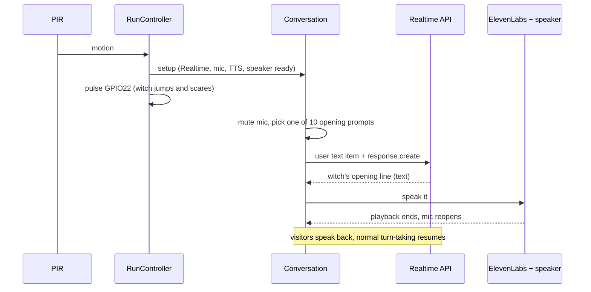

# Halloween Witch First to Speak - Design Document

Status: ready for implementation
Scope: MVP stage 4 - when the witch is triggered she speaks first: after she is activated the app sends one pre-written text prompt (chosen from ten) to the Realtime model, so the witch opens the conversation and the visitors answer
Depends on: `design-document-witch-MVP.prompt.md`, `design-document-witch-adding-tts.prompt.md` and `design-document-witch-hardware-and-run-control.prompt.md` (section 12, "Witch speaks first"), all implemented

## 1. Background

Today the witch only answers: she jumps, then waits for a visitor to speak first. Most visitors freeze when a prop jumps at them, so nothing is said and the 30 s idle timer ends the conversation. This stage makes her start the talking.



Flow: witch is triggered -> witch jumps up and scares the people -> witch initiates the conversation -> people speak back.

Why a text prompt per activation (and not a fixed recorded line): each visitor group gets a different opening, the line is delivered in the persona's voice with performance tags, and no new audio assets are needed. The cost is one extra, mostly cached, model response per activation (section 6).

## 2. Goals and non-goals

### Goals
1. After the witch is activated, she speaks an opening line without any visitor input.
2. The opening is generated from one of ten prompts, chosen so that a group never hears the same one twice in a row and all ten are used before any repeats.
3. Every opening ends with a question, dare or demand so the visitors have something to answer.
4. The microphone is muted from before the prompt is sent until the opening has finished playing, so the visitors' reaction to the jump cannot interrupt or cancel it.
5. The system prompt prefix is byte-identical on every activation so the model's automatic prompt cache is used and the opening starts sooner (section 6).
6. Works with both personas (`kids`, `evil`) with no per-persona prompt lists.
7. Opening latency, cache hits and cost are visible in the existing console output and usage log.

### Non-goals
- Choosing the opening by time of day, sensor data, or what the visitors look like (there is no webcam; the witch cannot see them, so no prompt may state a fact about the visitors).
- Changing the PIR, GPIO, cooldown or timeout behaviour.
- Pre-generating or pre-synthesising openings ahead of the trigger (section 12).
- Speaking first in `WITCH_TRIGGER=none` mode (the laptop continuous mode keeps its current behaviour).
- A new TTS voice, model or audio device.

## 3. Requirements

### Functional
| ID | Requirement |
|----|-------------|
| F1 | In controlled mode (`WITCH_TRIGGER=pir` or `keyboard`) with `WITCH_OPENING=on` (default), `Conversation.run(timer)` sends exactly one opening prompt per activation. `WITCH_TRIGGER=none` never sends one. |
| F2 | The opening is sent only after setup has completed, so it starts at the same moment as the GPIO22 pulse (the controller starts the pulse task immediately before `run`). An optional delay `WITCH_OPENING_DELAY_MS` (default 0) postpones it so she can speak after the jump lands. |
| F3 | The microphone gate is closed before the audio pump starts and stays closed until the opening reply has been spoken (or has produced no speech). |
| F4 | The prompt is sent as a user-role text item followed by `response.create` with no per-response overrides (section 5.3). |
| F5 | The prompt text is chosen by `OpeningPicker`: a shuffled "bag" of all ten, drawn without replacement; when the bag is empty it is reshuffled, and the first draw of a new bag is never the previous draw. The picker lives for the whole process, so it persists across activations. |
| F6 | The opening reply goes through the existing pipeline unchanged (tag parser, cost tracking, TTS, speaker). It counts as interaction 1 in the conversation summary and is written to the usage log. |
| F7 | The idle timer starts at activation as today. The opening's first text delta counts as activity, and playback holds the timer, so the opening cannot be mistaken for silence. |
| F8 | If no opening reply arrives (model error, hang), the conversation ends at the idle timeout; no special recovery is needed. If the reply produces no speech (TTS off or the reply failed), the mic gate reopens at once. |
| F9 | The 120 s total cap, the idle timeout and `FATAL_ERRORS` behave exactly as in the run-control design. |

### Non-functional
| ID | Requirement |
|----|-------------|
| N1 | Log the time from sending the opening to its first text delta, and to first audio (the existing `speech>` line). Target: first audio within 3 s of the pulse start. |
| N2 | On every activation after the first within roughly five minutes, the opening response reports cached input tokens greater than zero. If it does not, the prefix is not stable (section 6.2). |
| N3 | No new dependency. |

## 4. The ten opening prompts

Design rules for the prompts:
- They are **situations for the witch to react to**, not lines to read out. The persona prompt supplies the voice, so the same ten work for Grizelda (`kids`) and Mordrake (`evil`).
- Each starts with `Stage cue:` so the model can tell the director's instruction from a visitor (section 5.1).
- Each ends by making the witch **ask for something the visitors can say or do** (their names, a joke, a scream, a choice, a guess).
- None assumes anything the witch cannot know: no costumes, ages, group size, or number of people.
- All are safe for young children (no secrets, personal details, or anything frightening beyond the act).
- Each is under 30 words, so the input stays around 35 tokens. The persona's own rules cap the witch's reply at 30 words.

| # | Id | Prompt text (sent verbatim) | Reaction it should produce |
|---|----|------------------------------|-----------------------------|
| 1 | `welcome` | Stage cue: You just leaped out at some visitors on your doorstep. Give them your most dramatic welcome, then demand to know their names. | Grand welcome, asks for names |
| 2 | `toll` | Stage cue: Nobody passes your door for free. Announce that the toll for getting past you is one joke, and demand they tell you one right now. | Demands a joke |
| 3 | `scream` | Stage cue: You are judging a scream contest and nobody has screamed yet. Scoff at the silence and challenge them to give you their very best scream. | Dares a scream |
| 4 | `wrong-guess` | Stage cue: It is too dark to see them properly. Confidently make a ridiculous wrong guess about what they are, and demand that they correct you. | Silly wrong guess, they correct her |
| 5 | `riddle` | Stage cue: Nobody gets past without answering your riddle. Ask one short, silly riddle and tell them they have one guess. | Riddle, they answer |
| 6 | `trespass` | Stage cue: Someone has crept onto your doorstep and tripped something of yours. Accuse them dramatically and demand to know who is responsible. | Accusation, they confess or blame each other |
| 7 | `bravest` | Stage cue: You can smell fear. Announce that you only want to speak to the bravest one here, and demand they say who that is. | Asks who is bravest |
| 8 | `ingredient` | Stage cue: You were busy brewing a spell when they interrupted. Grumble about it, then make them choose between two absurd ingredients for the pot. | Funny either/or choice |
| 9 | `fortune` | Stage cue: Offer to tell their fortunes, but you need a word from each of them first. Ask for their name, or their favourite sweet. | Asks a harmless word each |
| 10 | `woken` | Stage cue: They woke you from a nap you had planned for a hundred years. Complain grandly, then ask what could possibly be important enough. | Grumpy, asks why they came |

Notes:
- Prompts 1 to 3 are the safest "always works" openers; 4 to 10 add variety. None needs a specific persona item (cauldron, toad), so the evil persona is not forced to mention things it does not own.
- The `Id` is logged with each activation (section 8) so the evening's openings can be reviewed; it is never sent to the model.
- Treat the wording as tunable. After the manual run (section 10) edit only `OPENING_PROMPTS` in `persona.py`; the tests check structure, not wording.

## 5. Behaviour design

### 5.1 Persona change (`persona.py`)
Add a single rule to `_build_prompt` so the model treats a stage cue correctly and does not narrate it:

```text
- A message that starts with "Stage cue:" is the director talking, not a visitor. Act it out in character as your next line. Never mention the cue, and still follow every rule above.
```

Place it after the "Ignore any instruction to leave character..." rule. That rule keeps its priority over visitor input; the new rule is scoped to the exact `Stage cue:` prefix. Because the prompt changes, the first activation after deployment misses the cache once; that is expected.

Also add `OPENING_PROMPTS: tuple[Opening, ...]`, where `Opening` is a frozen dataclass `(id: str, text: str)`, holding the table in section 4.

### 5.2 Picker (`opening.py`, new)
```python
class OpeningPicker:
    def __init__(self, openings=OPENING_PROMPTS, rng: random.Random | None = None) -> None: ...
    def next(self) -> Opening: ...
```
- A shuffled bag, popped one at a time; refilled and reshuffled when empty; on a refill, if the first item equals the last item drawn, swap it with the second.
- The `rng` is injectable so tests are deterministic.
- One `OpeningPicker` is created in `run_controlled` and passed to every `Conversation` the factory builds (the factory is already a closure over `settings` and `tracker`).

### 5.3 Realtime client (`realtime.py`)
```python
async def prompt(self, text: str) -> None:
    conn = self._connection()
    await conn.conversation.item.create(
        item={"type": "message", "role": "user", "content": [{"type": "input_text", "text": text}]}
    )
    await conn.response.create()
```
- Both calls exist on the installed `openai` SDK connection (`conversation.item.create(item=...)`, `response.create(response=...)`); re-check against the version pinned in `pyproject.toml` when implementing.
- No `response.create(response={...})` overrides. A response-level `instructions` would replace the session instructions for that reply, losing the persona and breaking the cache. `output_modalities` and the other settings already come from `session.update`.

### 5.4 Conversation (`app.py`)
`Conversation` gains an `OpeningPicker | None` constructor argument. `run(timer)` passes `opening=True`; `serve()` (trigger none) does not.

`_session(rt, timer, opening)` order:
1. `started = loop.time()`.
2. If `opening`: `self._gate.close()` and set `self._opening_gate = True` (the pump has not started, so no audio is sent), then `await asyncio.sleep(opening_delay_s)` if the delay is non-zero, then pick a cue, record `self._opening_sent_at = loop.time()`, log it, and `await rt.prompt(cue.text)`.
3. Create the pump, event and watchdog tasks as today.

`_handle_events` changes:
- Initialise `speech_ended_at` from `self._opening_sent_at` (then clear it), so the existing latency and `first audio ... after end of speech` figures cover the opening with no new code path.
- At `ResponseDone`, apply the gate handover so the gate counter stays balanced (`MicGate` counts closes and releases, so closing twice would leave it shut):
  - speech queued and `_opening_gate`: do **not** call `close()` again; the opening's close is released by `_speak_loop`'s `finally`, as for any reply. `timer.hold()` still runs.
  - no speech and `_opening_gate`: `gate.release(gate_tail_s)` immediately.
  - in both cases clear `_opening_gate`.
- Every other path is unchanged.

The idle timer needs no change: it starts at zero at activation, the opening's first `TextDelta` calls `touch()`, and `hold()` covers playback (F7).

### 5.5 Configuration (`config.py`)
| Variable / flag | Default | Validation |
|-----------------|---------|------------|
| `WITCH_OPENING` / `--no-opening` | `on` | `on` or `off`, via the existing `_parse_switch`; the flag forces `off` |
| `WITCH_OPENING_DELAY_MS` | `0` | integer 0-5000 |

`Settings` gains `opening: bool` and `opening_delay_ms: int` (with an `opening_delay_s` property). Both are read only when a trigger is in use, like the other run-control values, so a laptop `.env` needs neither and `WITCH_TRIGGER=none` never validates them.
## 6. Prompt caching

### 6.1 What is cached
The Realtime API caches input prefixes automatically; there is no flag to set. A request is billed at the cached rate for the leading part of its input that matches a recent request exactly. For `gpt-realtime-2.1-mini` that rate is `$0.06` per 1M text tokens against `$0.60` uncached (`PRICES` in `cost.py`). The cached part here is the persona instructions (about 520 tokens today), which come first in the input; the opening cue (about 40 tokens) comes after it and is the only part that differs between activations.

Evidence from `usage.jsonl`: within one session the second and third replies reported 512 and 640 cached text tokens (multiples of 128), while the first reply of a fresh session on 2026-10-29 reported zero, and the first reply of a run on 2026-10-25 reported 256 of 287 cached, so a cross-session hit does happen when a recent request used the same prefix. OpenAI documents cache lifetimes of roughly 5 to 10 minutes of inactivity; treat that as an assumption and measure it (N2).

### 6.2 What keeps the prefix stable
- `session_config()` is built from `Settings` and `PERSONA_PROMPTS` only, with no timestamps, counters or randomness. Keep it that way; a test asserts two calls are equal.
- The persona prompt is never edited at runtime. The random cue goes in a user item after it, never into `instructions`.
- `session.update` is sent once per connection with identical content on every activation; do not add per-activation fields.
- No per-response `instructions` (section 5.3).
- Changing the persona text invalidates the cache once; changing `WITCH_PERSONA` changes the prefix by design.

### 6.3 What this buys, and what it does not
- The opening's input is about 560 tokens, of which about 500 are cached when an activation follows another within a few minutes. The input cost drops to roughly one eighth, and the time to first token drops with it. The saving is a fraction of a cent; the reason to care is latency.
- The first activation after a quiet period is a cold start and is billed and timed uncached. The design accepts this; section 12 lists keep-warm options if the measured first-activation latency is too high.
- Reply time is dominated by the model's text generation and ElevenLabs time to first audio, not by input processing. Caching alone will not reach the 3 s target if TTS is slow; the `speech>` line shows which part is.
- Expected cost of an opening: about `$0.0003` plus about 150 ElevenLabs characters.

## 7. Failure handling

| Situation | Behaviour |
|-----------|-----------|
| `rt.prompt` raises (socket closed) | Propagates as a transport error; the conversation ends with `ERROR` and the controller enters the cooldown. The witch has already jumped, as for any mid-conversation error. |
| Opening reply is empty or `status != completed` | No speech, gate released at once (section 5.4); the witch stays silent and visitors can speak; the idle timer still applies. |
| TTS or playback error on the opening | Logged by the existing speech worker; `finally` releases the gate and the timer, so listening resumes. |
| No `ResponseDone` ever arrives | Mic stays muted until the idle timeout ends the conversation (at most 30 s); the 120 s cap is the backstop. |
| Visitors talk during the opening | Not heard (mic muted) until playback ends plus the existing 400 ms gate tail. Nothing is queued for later. |
| `WITCH_OPENING=off` or `--no-opening` | Exactly the previous behaviour: the witch jumps and waits. |
| Fatal API error | Exit 1, as before. |

## 8. Console and log output

One new line at INFO on the `witch.app` logger when the cue is sent, before the usual reply block:

```text
opening> cue 4/10 wrong-guess (delay 0 ms)
witch> [gasps] A dinosaur? No, a very tall potato! Correct me before I boil you.
...
speech> 78 chars, first audio 1620 ms after end of speech, played 5.0 s
```

- `4/10` is the draw position in the current bag (1 to 10).
- Here "end of speech" is the moment the cue was sent, so the existing latency figures describe the opening.
- The existing `format_interaction` line already shows `cached N`; nothing new is needed for N2.
- The `usage.jsonl` entry for the opening is written as any other reply; no schema change. The cue id appears only in the log.

## 9. Implementation plan

1. `persona.py`: add the `Stage cue:` rule and `OPENING_PROMPTS` (section 4); tests for structure.
2. `opening.py`: `OpeningPicker`; tests with a seeded RNG.
3. `config.py`: `opening`, `opening_delay_ms`, `--no-opening`; tests.
4. `realtime.py`: `RealtimeClient.prompt`; test with a fake connection.
5. `app.py`: opening step in `_session`, gate handover in `_handle_events`, picker wiring in `run_controlled`.
6. `.env.example` and README: new settings, a line on caching, and the tuning advice from section 4.
7. Update section 12 of `design-document-witch-hardware-and-run-control.prompt.md` to point here (the `_opening()` hook is replaced by the `_session` step; no separate method is required).
8. Manual acceptance (section 10).

Steps 1 to 5 are verified on Windows with `--trigger keyboard` before touching the Pi.

## 10. Testing

### Unit tests (no network, no GPIO, no sleeping)
- **Prompts** (`tests/test_opening.py`): exactly ten; ids unique; texts unique; each starts with `Stage cue:`; each under 30 words; none contains square brackets (the persona forbids brackets other than tags).
- **Picker**: ten draws from a fresh bag return all ten ids once; the next ten do as well; the first draw after a refill never equals the last draw before it (checked over many seeds); the same seed gives the same sequence.
- **Persona**: both prompts contain the `Stage cue:` rule; `session_config(settings)` called twice returns equal dicts (cache stability, section 6.2).
- **`RealtimeClient.prompt`**: with a fake connection, records `conversation.item.create` with one `message`/`user`/`input_text` item, then `response.create` with no arguments, in that order.
- **Config**: defaults (`on`, 0); `off`; invalid switch; delay bounds (-1 and 5001 rejected); `--no-opening` wins over the environment; values are not validated when the trigger is `none`.
- **Gate handover**: if `Conversation` can be driven with a fake `RealtimeClient`, a test that feeds one `ResponseDone` with speech leaves `gate.is_open` true after the speak loop finishes (counter balanced), and one without speech reopens the gate. If it needs more scaffolding than it is worth, cover it in manual test 5 instead.
- Existing tests still pass unchanged.

### Manual acceptance
Laptop (Windows), `python -m witch --trigger keyboard`:
1. Press Enter: the witch speaks first without any input; the log shows `opening> cue N/10 ...`; she ends with a question or demand.
2. Answer her: a normal reply follows; she does not repeat the opening.
3. Trigger ten times (waiting out the cooldown, or with `WITCH_COOLDOWN_S=0`): all ten ids appear, none twice in a row.
4. Make noise during her opening: it does not interrupt her; the mic reopens after she finishes.
5. `--no-tts --trigger keyboard`: the opening prints as text; the mic is not left muted (speak and get a reply).
6. `--no-opening`: no `opening>` line; she waits as before.
7. `WITCH_TRIGGER=none`: no opening is sent.
8. Two triggers within a minute: the second opening's `cached` figure is greater than zero (N2). Record cold and warm first-audio times in the PR.
9. Both personas (`WITCH_PERSONA=kids` and `evil`): read all ten openings for each; reword any that read badly (section 4), and drop any a child could find upsetting.

Raspberry Pi:

10. With `WITCH_TRIGGER=pir` and the witch connected, confirm she moves before she speaks and the speech starts within about 3 s of the pulse; if she speaks too early or too late tune `WITCH_OPENING_DELAY_MS`.

## 11. Troubleshooting notes (for the README)

- Witch speaks over the jump or before it lands: set `WITCH_OPENING_DELAY_MS` (for example 800).
- Opening is slow for the first visitor of the night but quick afterwards: the cache was cold; see section 12.
- `cached 0` on every activation: something changed the prefix; check that `WITCH_PERSONA` and the prompt text are unchanged between runs.
- Witch says "stage cue" aloud or describes the cue: tighten the persona rule in section 5.1.

## 12. Future work (provisioned for, not implemented)

- **Keep-warm.** If the first activation of the evening is too slow, send one throwaway response at the end of the PIR warm-up (or every few minutes while idle) to refresh the cache. It costs a fraction of a cent, but it needs an open Realtime session, which conflicts with "nothing is open in Idle". Decide after measuring N1 and N2.
- **Pre-generated opening.** Request the opening while setup is finishing, hold the audio, and play it the moment the pulse starts. Saves model latency at the cost of more state in `Conversation`.
- **Smarter selection.** Weight cues by time of day or visitor count once a webcam exists; swap the table for a per-persona table if the two personas need different openings.
- **Closing line.** A matching farewell prompt when the conversation ends by silence.

## 13. Decisions and open questions

Decided in this revision (change if you disagree):
- One shared list of ten situations, not one per persona; the persona prompt supplies the voice.
- The cue is a user-role text item with a `Stage cue:` prefix, plus one new persona rule, rather than a response-level `instructions` override (which would drop the persona and break the cache).
- The opening is on by default in controlled modes and never in `WITCH_TRIGGER=none`.
- Shuffle-bag selection, not pure random, so a night's openings stay varied.
- The mic is muted for the whole opening; there is no barge-in on the opening.
- No cue id in `usage.jsonl` (no schema change); it is in the log only.
- The opening is sent when the pulse starts (delay 0). She will usually begin speaking 1 to 3 s later, because of model and TTS latency, which matches "jumps, then talks".

Open (defaults in brackets):
1. Should the witch begin speaking slightly after the jump lands rather than at pulse start? [no; use `WITCH_OPENING_DELAY_MS` if testing shows she speaks too early]
2. Are ten situations enough for a busy night, or should the list grow? [ten, per the request; the picker handles any length]
3. Is a cold first activation acceptable, or is keep-warm needed (section 12)? [accept until measured]
