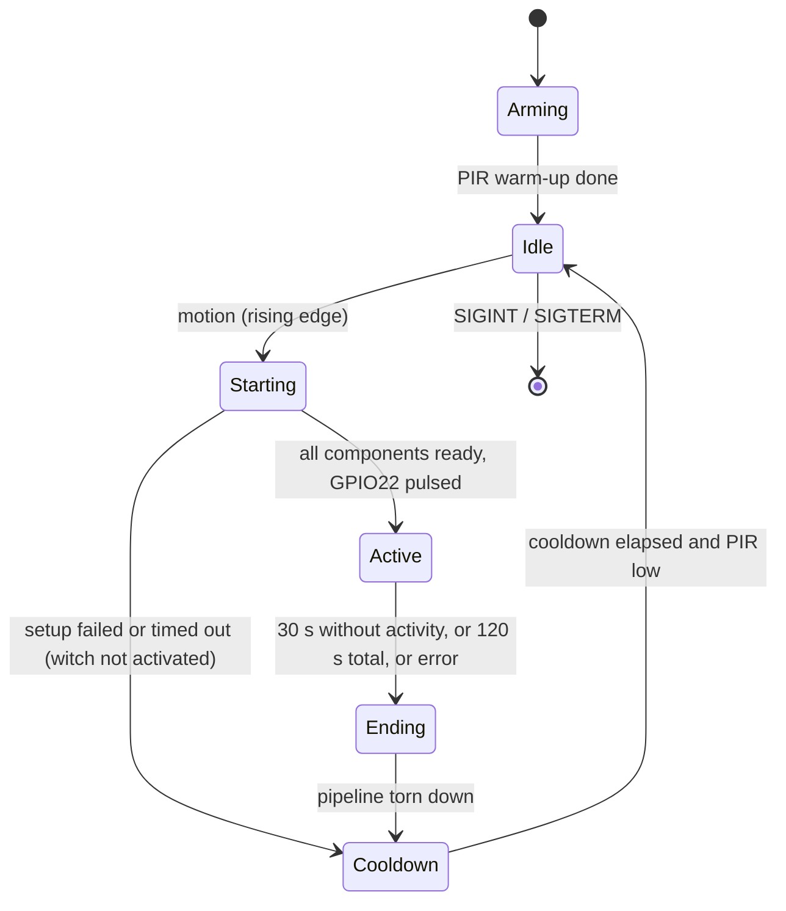

# Halloween Witch Hardware and Run Control - Design Document

Status: ready for implementation
Scope: MVP stage 3 - run the witch unattended on a Raspberry Pi Zero 2 W: a PIR sensor starts a conversation, a GPIO output makes the witch jump and flash her eyes, and the app returns to sleep when the conversation ends
Depends on: `design-document-witch-MVP.prompt.md` (stage 1) and `design-document-witch-adding-tts.prompt.md` (stage 2), both implemented

## 1. Background

Today `python -m witch` opens the microphone and the Realtime connection once and talks until Ctrl+C. That is fine on a laptop but wrong for the prop: it would listen (and bill) all night. This stage adds:

1. A PIR motion sensor that wakes the witch.
2. One GPIO output that triggers the witch's built-in "jump and flash eyes" routine.
3. A run-control loop that builds the whole voice pipeline on demand, ends the conversation on silence or a time cap, then sleeps for a cooldown.



## 2. Goals and non-goals

### Goals
1. Motion on the PIR starts exactly one conversation; motion during a conversation or cooldown is ignored.
2. The witch is activated (GPIO22 high for 1 s) only after the voice pipeline is ready, so she can speak the moment she moves.
3. A conversation ends after 30 s without activity or 120 s in total, whichever comes first.
4. After a conversation the system is fully quiet (no microphone, no Realtime session, no PIR triggers) for a configurable cooldown.
5. Output pins are always left low on exit, crash or signal, and are low while the Pi boots.
6. All hardware sits behind small protocols so the app runs and is tested on Windows with no GPIO (keyboard trigger, logging output).
7. The design must not block the future enhancements in section 12.

### Non-goals
- A second output for the LED eyes, and making the witch speak first (section 12).
- Mid-conversation reconnects; the Realtime session is not resumed (section 8).
- Reading the witch's own sensors or button state.
- Barge-in, webcam, or any other new input.
- Hot-plugging hardware or auto-detecting pins; pins come from configuration.

## 3. Hardware

All pin numbers are **BCM (GPIO) numbers**, not physical header positions.

| Function | BCM pin | Direction | Notes |
|----------|---------|-----------|-------|
| PIR power | GPIO17 | output, driven high | Pin supplies the sensor, see assumptions |
| PIR signal | GPIO27 | input, internal pull-down | High = motion |
| Witch activate | GPIO22 | output, active high, initial low | One line triggers both the jump and the eye flash |

Pull-down note: an internal pull-down only matters while a pin is an input. GPIO22 is an output driven low by the app, so the pull-down requirement is met two other ways:
- At boot and reset the Pi defaults GPIO22 to an input with pull-down, so the witch does not fire during boot.
- After the process exits, or is killed with SIGKILL, the pin is released and the internal pull is not guaranteed. **Fit a 10 kΩ external pull-down from GPIO22 to GND** so the witch never fires on its own. GPIO27 uses the internal pull-down (`pull_up=False`), which keeps it low if the PIR is unplugged.

Hardware assumptions to verify before wiring (record the result in the PR):
1. **PIR supply voltage.** A GPIO pin provides 3.3 V and about 16 mA at most. That is fine for 3.3 V-capable modules (for example AM312, HC-SR602) but **not** for an HC-SR501, which needs 5 V (4.5 V minimum). If the sensor needs 5 V, power it from a 5 V header pin and treat GPIO17 as optional (`WITCH_PIR_POWER_PIN=` empty disables it; the PIR signal must still be 3.3 V logic).
2. **Witch input.** GPIO22 is 3.3 V logic and sources only a few mA. Confirm it drives the witch's trigger input (transistor, opto-isolator, or relay board with flyback protection), not a coil directly.
3. **PIR timing.** Most PIRs hold their output high for 2.5 s to several minutes after motion, and need 30-60 s after power-up to stabilise. Set the sensor's hold time to the minimum (the app has its own cooldown).

Powering the PIR from GPIO17 also lets the app power-cycle it; this stage only drives it high at start-up and low on exit.

## 4. Requirements

### Functional
| ID | Requirement |
|----|-------------|
| R1 | On start, set GPIO22 low, drive GPIO17 high, then ignore the PIR for the warm-up period (default 60 s). |
| R2 | In `Idle`, a rising edge on GPIO27 (debounced) starts an activation. Nothing else is open in `Idle`: no microphone, speaker, TTS client or Realtime session. |
| R3 | `Starting` opens the Realtime session (including `session.update`), the microphone, the speaker and the TTS client. It is ready when all four are open. The whole step has a timeout (default 20 s). |
| R4 | When ready, pulse GPIO22 high for the activation time (default 1000 ms), then set it low. The pulse runs concurrently with the conversation and never delays it. |
| R5 | The conversation ends at the first of: idle timeout (default 30 s, see R6), total timeout (default 120 s, measured from the start of the pulse), fatal or transport error, SIGINT/SIGTERM. |
| R6 | "Activity" resets the idle timer: visitor speech starts or stops, the witch's reply starts arriving, the witch's audio finishes playing. The idle timer is paused while the witch is speaking or has speech queued, and restarts when playback ends. At activation the timer starts at zero. |
| R7 | At the total timeout, playback is stopped immediately, even mid-sentence. |
| R8 | On end, cancel playback, close the Realtime session, microphone, speaker and TTS client, and make sure GPIO22 is low. Log a one-line summary (reason, duration, interactions, cost). |
| R9 | After `Ending`, sleep for the cooldown (default 30 s) during which PIR edges are discarded. |
| R10 | Re-arming after the cooldown requires the PIR to be low, then a new rising edge. A PIR stuck high never causes repeated activations. |
| R11 | If setup fails or times out, do not pulse GPIO22, log the error, tear down what was opened, and enter the cooldown. |
| R12 | Fatal API errors (authentication, permission, not found, bad request) exit the process with code 1, as today. Any other error during a conversation ends that conversation and enters the cooldown; the process keeps running. |
| R13 | GPIO22 is driven low on every exit path: normal exit, exception, Ctrl+C and SIGTERM. |
| R14 | `WITCH_TRIGGER=none` (default) keeps today's always-listening behaviour unchanged. |
| R15 | `--trigger keyboard` (Enter key = motion) and a logging fake output allow the whole flow on a laptop with no GPIO. |
| R16 | `--hw-test` prints the PIR level for 10 s, pulses GPIO22 once, then exits. No network and no audio. Used for wiring bring-up. |

### Non-functional
| ID | Requirement |
|----|-------------|
| N1 | `gpiozero` is imported lazily, only when `WITCH_TRIGGER=pir`; Windows installs and tests never need it. |
| N2 | The idle timer and state machine are pure logic with an injectable clock, so they are unit tested without sleeping. |
| N3 | GPIO callbacks run on library threads. They only call `loop.call_soon_threadsafe`; no application logic runs on them. |
| N4 | Idle power: while in `Idle` or `Cooldown` the process does no audio I/O and makes no network calls. |
| N5 | Setup time on the Zero 2 W is logged (`ready in N ms`) so the real delay between motion and the witch moving is known. |

## 5. Technology choices

| Concern | Choice | Reason |
|---------|--------|--------|
| GPIO | `gpiozero` with the `lgpio` pin factory | Default on Raspberry Pi OS Bookworm, callbacks, `pull_up=False`, `initial_value=False`, pin cleanup on exit. `RPi.GPIO` is not used. |
| Install | Optional extra: `pi = ["gpiozero>=2.0"]`; `lgpio` comes from apt (`python3-lgpio`) with `python3 -m venv --system-site-packages .venv` | `lgpio` needs a compiler and swig via pip; the apt package avoids building on the Zero. Verify on the device and document the working recipe in the README. |
| Concurrency | `asyncio` in one process | Matches the existing app. |
| Service | `systemd` unit with `Restart=on-failure` | Starts on boot, restarts on crash, sends SIGTERM on stop. |

## 6. Project structure (changes only)

```text
src/witch/
  control.py            # NEW: RunController state machine, IdleTimer, EndReason
  hardware/
    __init__.py         # NEW
    base.py             # NEW: MotionSensor and ActivationOutput protocols
    gpio.py             # NEW: gpiozero implementation (lazy import)
    fake.py             # NEW: KeyboardSensor, LoggingOutput (laptop / tests)
  app.py                # CHANGED: conversation extracted from run(); new run_controlled()
  config.py             # CHANGED: new settings (section 7.5)
  __main__.py           # CHANGED: --trigger, --hw-test, SIGTERM handling
deploy/
  witch.service         # NEW: systemd unit
tests/
  test_control.py       # NEW
  test_hardware_fake.py # NEW
  test_config.py        # CHANGED: new settings
pyproject.toml          # CHANGED: [project.optional-dependencies] pi
README.md               # CHANGED: Raspberry Pi wiring, service, new variables
.env.example            # CHANGED: new variables (commented)
```

## 7. Architecture

### 7.1 Hardware protocols (`hardware/base.py`)

```python
class MotionSensor(Protocol):
    async def __aenter__(self) -> "MotionSensor": ...   # powers the PIR, starts watching
    async def __aexit__(self, *exc) -> None: ...        # powers it down, releases pins
    @property
    def is_active(self) -> bool: ...                    # current PIR level
    async def wait_for_motion(self) -> None: ...        # returns on the next rising edge
    async def wait_for_still(self) -> None: ...         # returns when the level is low (immediately if already low)

class ActivationOutput(Protocol):
    async def __aenter__(self) -> "ActivationOutput": ...   # configures the pin, drives low
    async def __aexit__(self, *exc) -> None: ...            # drives low, releases the pin
    async def pulse(self, duration_s: float) -> None: ...   # high, wait, low; low again if cancelled
```

- `wait_for_motion` discards edges that occurred before it was called, so cooldown edges never leak into the next wait. Implementation: an `asyncio.Event` set from the GPIO thread via `call_soon_threadsafe`, cleared immediately before each wait begins.
- `pulse` uses `try/finally` so that an error or cancellation still sets the pin low. A normal conversation end waits for the pulse to finish, so a short conversation still fires the witch. Overlapping pulses are not allowed; a second call while one is running raises `RuntimeError`.

### 7.2 GPIO implementation (`hardware/gpio.py`)

- `GpioMotionSensor(settings)`: `DigitalOutputDevice(power_pin, initial_value=True)` if configured; `DigitalInputDevice(pir_pin, pull_up=False, bounce_time=0.05)`; `when_activated` bridges to the loop. `__aexit__` closes both devices (power low).
- `GpioActivationOutput(settings)`: `DigitalOutputDevice(activate_pin, active_high=True, initial_value=False)`. `pulse` = `on()`, `await asyncio.sleep(duration_s)`, `off()` in `finally`.
- Any `gpiozero` error at construction raises `HardwareError("GPIO unavailable: ...")` with a hint about the `gpio` group and `--system-site-packages`. The process exits with code 1.

### 7.3 Fake hardware (`hardware/fake.py`)

- `KeyboardSensor`: a thread blocking on `sys.stdin.readline()` sets the motion event; each Enter is one rising edge; `is_active` is always false after the edge so `wait_for_still` returns immediately. Warm-up is skipped.
- `LoggingOutput`: logs `witch output HIGH` / `LOW` with timestamps; `pulse` sleeps for the duration. Used with the keyboard trigger and as the test double base.

### 7.4 Run control (`control.py`)

```python
class EndReason(Enum):
    IDLE_TIMEOUT = "idle timeout"
    MAX_DURATION = "max duration"
    ERROR = "error"
    SHUTDOWN = "shutdown"

class IdleTimer:
    def __init__(self, idle_s: float, max_s: float, clock=time.monotonic): ...
    def start(self) -> None                 # idle and total counters begin at now
    def touch(self) -> None                 # activity: reset the idle counter
    def hold(self) -> None                  # +1 hold (witch speaking or speech queued); idle counter paused
    def release(self) -> None               # -1 hold; touch() when it reaches 0
    def expired(self) -> EndReason | None   # MAX_DURATION wins over IDLE_TIMEOUT if both are due
    def seconds_until_deadline(self) -> float
```

`hold`/`release` mirror `MicGate.close`/`release` and raise `RuntimeError` on an unmatched `release`. Total time is never paused.

```python
class RunController:
    def __init__(self, settings, sensor, outputs: Sequence[ActivationOutput], conversation: ConversationFactory): ...
    async def run(self) -> int          # Arming -> Idle -> ... loop; returns the process exit code
```

Loop:

```text
arm:       await asyncio.sleep(warmup_s)                      # skipped for the keyboard sensor
loop:
  await sensor.wait_for_motion()                              # Idle
  async with conversation.open() as convo:                    # Starting (timeout: setup_timeout_s)
        -> on failure/timeout: log, cooldown, continue (R11)
        start IdleTimer
        pulse all outputs concurrently (background task)      # Active
        reason = await convo.run(timer)                       # returns EndReason
  log summary                                                 # Ending
  await asyncio.sleep(cooldown_s)                             # Cooldown
  await sensor.wait_for_still()                               # R10
```

`ConversationFactory` is the seam to `app.py` (below) so the controller is tested with a fake conversation.

### 7.5 Conversation (`app.py`)

Refactor, preserving existing behaviour for `WITCH_TRIGGER=none`:

- Extract the body of `run()` into `Conversation`, an async context manager built from `Settings`, the shared `CostTracker`, and a `MicGate` and speech queue created per conversation.
  - `__aenter__` is the **setup** step: enter `RealtimeClient`, `MicSource`, and, when TTS is enabled, `ElevenLabsTTS` and `SpeakerSink` (via `AsyncExitStack`), then start the `_speak_loop`. Ready means all context managers have entered.
  - `__aexit__` cancels the speak task (which stops playback), then closes everything in reverse order.
  - `run(timer)` runs `_pump_audio`, `_handle_events`, and a **watchdog** task concurrently; it returns the `EndReason` of whichever finishes first and cancels the rest.
- The watchdog sleeps `timer.seconds_until_deadline()`, re-checks `timer.expired()`, and loops. At `MAX_DURATION` it cancels the speak task first so audio stops at once (R7).
- Activity hooks (all optional; `None` when `WITCH_TRIGGER=none`):
  - `_handle_events`: `timer.touch()` on `SpeechStarted`, `SpeechStopped`, and the first `TextDelta` of a response.
  - `gate.close()` at `ResponseDone` also calls `timer.hold()`; `_speak_loop`'s `finally` calls `timer.release()` next to `gate.release()`. A reply that produces no speech holds nothing.
  - With `--no-tts` nothing is spoken, so the first `TextDelta` and `ResponseDone` are the witch's only activity.
- Reconnect-on-error (the existing backoff loop in `run()`) is used only by `WITCH_TRIGGER=none`. In controlled mode a retryable error returns `EndReason.ERROR` and the controller enters the cooldown; the next motion starts a fresh session with no conversation history. `FATAL_ERRORS` propagate and exit with code 1 (R12).
- A hook point for the future "witch speaks first" feature: `Conversation.run(timer)` calls `await self._opening()` after the pulse is started; it is a no-op now (section 12).
- `run_controlled(settings)` builds the sensor and outputs from `settings.trigger`, creates the `CostTracker`, runs `RunController`, and prints the run total in `finally`.

### 7.6 Entry point (`__main__.py`)

- `--trigger {none,pir,keyboard}` overrides `WITCH_TRIGGER`; `--hw-test` implements R16.
- Install a SIGTERM handler that raises `KeyboardInterrupt` in the main task (`loop.add_signal_handler(SIGTERM, task.cancel)` on POSIX; skipped on Windows). Without it Python's default SIGTERM action ends the process without running `finally`, leaving GPIO22 undefined, which would defeat R13.
- `asyncio.CancelledError` from the signal is treated as a clean stop: exit code 0, message `Stopped.`.

### 7.7 Configuration (`config.py`)

Settings are added to the frozen `Settings` dataclass and loaded with the existing `_get` / `_parse_int` helpers. Add `_parse_float(environ, name, default, minimum)` alongside them.

| Variable | Default | Validation |
|----------|---------|------------|
| `WITCH_TRIGGER` | `none` | `none`, `pir` or `keyboard` |
| `WITCH_PIR_PIN` | `27` | integer 0-27 |
| `WITCH_PIR_POWER_PIN` | `17` | integer 0-27, or empty to disable |
| `WITCH_ACTIVATE_PIN` | `22` | integer 0-27 |
| `WITCH_PIR_WARMUP_S` | `60` | float >= 0 |
| `WITCH_ACTIVATE_MS` | `1000` | integer >= 1 |
| `WITCH_IDLE_TIMEOUT_S` | `30` | float > 0 |
| `WITCH_MAX_CONVERSATION_S` | `120` | float > 0 and >= `WITCH_IDLE_TIMEOUT_S` |
| `WITCH_COOLDOWN_S` | `30` | float >= 0 |
| `WITCH_SETUP_TIMEOUT_S` | `20` | float > 0 |

- The three pins must be distinct (the power pin is excluded when disabled), otherwise `ConfigError`.
- Pin and timing values are only validated when `WITCH_TRIGGER != none`, so a laptop `.env` needs none of them.
- Error messages follow the existing style, for example `WITCH_IDLE_TIMEOUT_S must be greater than 0`. Never print API keys.

## 8. Failure handling

| Situation | Behaviour |
|-----------|-----------|
| GPIO library or permissions missing | Exit 1 with an actionable message before anything is opened. |
| Setup error or timeout (network down, audio device missing) | No pulse, log the error, tear down, cooldown (R11). |
| Retryable Realtime error mid-conversation | End conversation (`ERROR`), cooldown. No reconnect. |
| TTS or playback error | Logged, conversation continues (existing stage 2 behaviour). |
| Fatal API error (auth, bad request) | Exit 1. systemd restarts it (see 9), which fails the same way; the start limit stops the loop and the journal shows the error. |
| Unexpected exception in a conversation | Log with traceback, tear down, cooldown; the process stays up. |
| PIR stuck high | Warm-up still completes; after the first conversation `wait_for_still` blocks, so no repeat activations (R10). Log a warning once the wait exceeds 60 s. |
| SIGTERM / Ctrl+C at any state | Cancel the current wait or conversation, drive GPIO22 low, close everything, exit 0. |

## 9. Deployment (`deploy/witch.service`)

```ini
[Unit]
Description=Halloween Witch
After=network-online.target sound.target
Wants=network-online.target
StartLimitIntervalSec=300
StartLimitBurst=5

[Service]
Type=simple
User=pi
Group=gpio
WorkingDirectory=/home/pi/Halloween-Witch
EnvironmentFile=/home/pi/Halloween-Witch/.env
Environment=WITCH_TRIGGER=pir
ExecStart=/home/pi/Halloween-Witch/.venv/bin/python -m witch
Restart=on-failure
RestartSec=5
TimeoutStopSec=10

[Install]
WantedBy=multi-user.target
```

- The user, path and groups (`gpio`, `audio`) are examples; the README documents how to adjust them.
- Install with `sudo cp deploy/witch.service /etc/systemd/system/ && sudo systemctl enable --now witch`; logs with `journalctl -u witch -f`.
- `WITCH_USAGE_LOG` should point to a writable path; the default `usage.jsonl` is relative to `WorkingDirectory`.

## 10. Console and log output

State changes are logged at INFO on the `witch.control` logger, one line each:

```text
state> arming: PIR warm-up 60 s
state> idle: waiting for motion
state> starting: motion detected
state> active: ready in 1840 ms, witch activated (GPIO22 high for 1000 ms)
state> ending: idle timeout after 47.2 s, 3 interactions, $0.0112
state> cooldown: 30 s
```

Per-reply console output from stage 2 is unchanged.

## 11. Implementation plan

1. `config.py`: new settings and validation, with tests.
2. `hardware/base.py`, `hardware/fake.py`; tests for the motion event semantics and `pulse` cancellation.
3. `control.py`: `IdleTimer` with tests using a fake clock.
4. `app.py`: extract `Conversation`; keep `WITCH_TRIGGER=none` behaviour and tests green; add the timer hooks.
5. `control.py`: `RunController` with fake sensor, output and conversation; tests for the state flow.
6. `hardware/gpio.py`, `--hw-test`, `--trigger`, SIGTERM handling.
7. `deploy/witch.service`, `pyproject.toml` extra, `.env.example`, README (wiring table, install recipe, service, troubleshooting).
8. Manual acceptance (section 13).

Steps 1-5 are completed and verified on Windows before touching the Pi.

## 12. Future work (provisioned for, not implemented)

- **Eye-flash output.** `RunController` takes `outputs: Sequence[ActivationOutput]` and pulses them concurrently, so a second GPIO (with its own pin and duration settings) is a new `ActivationOutput` instance and a config entry. No change to the controller or conversation. For now the list has one element (GPIO22).
- **Witch speaks first.** `Conversation._opening()` is the hook. A later change sends a text item plus `response.create` through a new `RealtimeClient.prompt(text)` method after activation. The idle timer already starts at activation, so a witch that speaks first behaves correctly with no timer changes.
- Optional keep-warm of the Realtime connection if the measured setup time (N5) is too slow for a walking visitor.

## 13. Testing

### Unit tests (no network, no GPIO, no sleeping)
- `IdleTimer`: idle expiry; `touch` resets; `hold` pauses and `release` restarts at zero; total cap not paused; both due returns `MAX_DURATION`; unmatched `release` raises.
- `RunController` with fakes: full cycle order; motion during `Starting`, `Active` and `Cooldown` is ignored; setup failure and setup timeout skip the pulse and enter the cooldown; error in a conversation enters the cooldown and the loop continues; `FATAL_ERRORS` return exit code 1; stuck-high sensor does not re-trigger (R10); cancellation sets the output low.
- `pulse`: high for the duration then low; cancellation mid-pulse leaves it low; overlapping call raises.
- `KeyboardSensor` / event bridge: edges before `wait_for_motion` are discarded.
- Config: defaults, each variable's bounds, distinct pins, max >= idle, validation skipped when trigger is `none`.
- Existing stage 1 and 2 tests still pass unchanged.

### Manual acceptance
Laptop (Windows):
1. `python -m witch --trigger keyboard --no-tts`: Enter starts a conversation, silence for 30 s ends it, Enter during cooldown does nothing.
2. Same with TTS and headphones; talk continuously and confirm the 120 s cap stops playback.

Raspberry Pi Zero 2 W (bench first: multimeter or LED on GPIO22, witch **disconnected**):
3. `python -m witch --hw-test`: PIR level follows motion; GPIO22 shows 3.3 V for 1 s.
4. GPIO22 stays low through a reboot and after `kill -9`.
5. `WITCH_TRIGGER=pir`: walk past the sensor; pulse arrives after setup; check the logged setup time.
6. `sudo systemctl stop witch` during a conversation ends within 10 s with GPIO22 low.
7. Unplug the network and trigger: no pulse, the app recovers on the next motion.
8. Connect the witch; run a full evening-length soak (1 h, repeated triggers) and watch memory and CPU.

## 14. Troubleshooting notes (include in README)

- `GPIO unavailable`: add the user to the `gpio` group (`sudo usermod -aG gpio $USER`, then log in again); with a venv use `--system-site-packages` so `lgpio` is visible.
- PIR triggers immediately at start: warm-up too short; raise `WITCH_PIR_WARMUP_S`.
- PIR triggers constantly or never re-arms: shorten its hold-time trimmer and check the 3.3 V logic level and the GPIO27 wiring.
- Witch jumps before it can speak, or visitors walk past first: read the `ready in N ms` log; see section 12.
- No audio under systemd: add the service user to the `audio` group and set `WITCH_INPUT_DEVICE` / `WITCH_OUTPUT_DEVICE`.

## 15. Decisions and remaining open questions

Answered (recorded from review):
1. PIR is a 3.3 V module, so it is powered from GPIO17 and the signal is 3.3 V logic.
2. The witch input is 3.3 V logic with a 1 s pulse. It drives a MOSFET that switches the witch.
3. After a cooldown, the first motion does not trigger if the PIR is still high. Re-arm needs low, then high (R10).
4. Mic, speaker and Realtime session are opened per activation.

Decided in this revision (change if you disagree):
- Setup failure does not fire the witch (a silent jump looks like a fault).
- The 120 s cap hard-stops playback mid-sentence; no grace period.
- Re-arm requires the PIR to go low, then high; a visitor who keeps moving through the cooldown does not retrigger until they pause.
- Idle time excludes the witch's own speech, so a long reply never counts as silence.
- The 120 s total starts when the pulse starts, not at motion, so setup time is not charged to the conversation.
- Any mid-conversation connection error ends the conversation; no reconnect and no resumed context.
- `WITCH_TRIGGER=none` remains the default so existing behaviour and docs do not change.

Open (defaults in brackets):
1. Is the PIR a 3.3 V module? [assume yes; otherwise use 5 V pin and leave `WITCH_PIR_POWER_PIN` empty]
  - yes PIR module is 3.3 V
2. What does the witch's trigger input require (logic level, current, minimum pulse)? [3.3 V, 1 s]
  - logic level for 1s  (it drives a mosfet that then drives a switch on the witch)
3. Should the first motion after a cooldown trigger immediately if the PIR is still high? [no, per R10]
  - no
4. Persistent microphone and speaker with only the Realtime session per activation, if setup latency is too long? [per-activation until measured]
 - per activation
